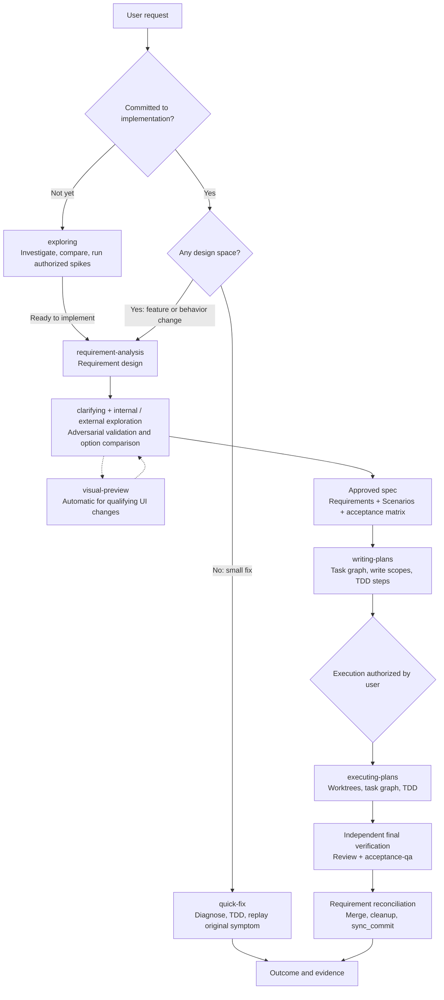

# spec-dev

**English | [简体中文](README.zh-CN.md)**

> From an idea to a design, from a design to a plan, and from a plan to evidence-backed delivery.

[Changelog](CHANGELOG.md) · [License](LICENSE) · [Issues](https://github.com/FlameMida/spec-dev/issues)

**spec-dev** is a spec-driven development plugin for Claude Code, Codex, Grok Build, Pi, and generic Agent Plugins hosts. It turns a request into an approved spec, decomposes the spec into an independently verifiable task graph, implements it with TDD discipline in isolated workspaces, and finishes with independent verification, review, acceptance, and Requirement reconciliation.

It is not a rigid pipeline that must always start at the beginning: its 14 skills work together or independently. Use `exploring` before committing to implementation, `quick-fix` for a small bug, `writing-plans` when a spec already exists, or `executing-plans` when a plan is ready. DDD modeling, browser prototypes, real-time search, and `wtf` terminal explanations are included as well.

<a id="overview"></a>
## Overview and end-to-end workflow



The three main entry points are routed by **commitment to delivery** and **design space**. The main workflow reuses disciplines such as `using-git-worktrees`, `test-driven-development`, and `test-strategy`; `anysearch`, `ddd-lifecycle`, and `wtf` also work on their own. Design approval, plan approval, and execution authorization are separate decisions: reading a document or generating a plan never implicitly starts implementation.

<a id="navigation"></a>
## Quick navigation

- **[Quick start](#quick-start)** — [Install](#install) · [First use](#first-run) · [Platform support](#platform-support) · [Runtime dependencies](#runtime-dependencies)
- **[Skill guide](#skill-guide)** — [Think and design](#design-skills) · [Plan and execute](#delivery-skills) · [Quality and repair](#quality-skills) · [Search and explain](#utility-skills)
- **[Mechanisms, benefits, and characteristics](#mechanics)** — artifact contracts, approval boundaries, parallel recovery, quality evidence, drift guards, and cross-platform degradation
- **Reference** — [Utility commands](#commands) · [Maintenance and releases](#maintenance) · [Directory layout](#directory-layout)

---

<a id="quick-start"></a>
## Quick start

### 1.1 Prerequisites

For the complete development workflow, you should have:

- a supported agent host and a Git project;
- `git` for worktrees, task commits, delivery, and drift guards;
- **Node.js ≥ 18** for contract validation, guardrails, doctor, and the visual-preview server;
- browser, performance, or AI-driven acceptance tools only when the corresponding checks need them.

> **Install from `dist`.** The `main` branch contains development sources; `dist` contains installable files generated from release tags and excludes this repository's own development `.spec-dev/` archive. After installation, spec-dev still reads and writes **your project's** `.spec-dev/` normally.

<a id="install"></a>
### 1.2 Install the plugin

#### Claude Code

Run these commands in Claude Code:

```bash
/plugin marketplace add https://github.com/FlameMida/spec-dev.git#dist
/plugin install spec-dev@spec-agent-skills
```

#### Codex

Run these commands in a terminal:

```bash
codex plugin marketplace add https://github.com/FlameMida/spec-dev.git --ref dist
codex plugin add spec-dev@spec-agent-skills
```

After a new release, run `codex plugin marketplace upgrade spec-agent-skills`. Codex 0.164.0 should use the Git `dist` entry above. After installation, the plugin page should list four hooks; review and trust them before use. The plugin never grants trust automatically.

#### Pi and Grok Build

```bash
# Pi
pi install git:github.com/FlameMida/spec-dev@dist

# Grok Build direct installation
grok plugin install https://github.com/FlameMida/spec-dev.git@dist
```

Grok Build also honors `source.ref: "dist"` in a marketplace plugin entry. Do not mechanically apply the direct-install `@dist` suffix to a `grok plugin marketplace add` source URL.

#### Generic Agent Plugins 1.0.0 packages

Portable hosts can consume the ZIP / tar.gz produced by the distribution workflow; npm distribution uses the tgz produced by `npm pack`. Agent Plugins 1.0.0 specifies a package format, not a universal Git installation command, so Git ref selection depends on the host. Portable packages retain the root `plugin.json`; the Git `dist` package omits it for Codex hook compatibility.

<a id="first-run"></a>
### 1.3 First use: start with a real request

The examples below are **natural-language prompts for your agent**, not shell commands, so they do not depend on one host's invocation prefix. You can also use the skill command displayed by your host; hosts with plugin namespaces may show `/spec-dev:<skill>`.

#### Route A: complete feature delivery

1. **Design the requirement**

   > Use requirement-analysis to design team-member invitations for this project, including permissions, failure paths, and acceptance criteria.

2. **Review and approve the design**. The agent investigates the current system, clarifies one decision at a time, and compares options. It writes the spec only after your approval. A typical path is:

   ```text
   .spec-dev/<date-sequence-feature>/spec/<feature>-design.md
   ```

3. **Create an implementation plan**

   > Use writing-plans to turn .spec-dev/&lt;feature&gt;/spec/&lt;feature&gt;-design.md into an independently verifiable implementation plan.

4. **Review the plan and explicitly authorize execution**

   > Use executing-plans to execute .spec-dev/&lt;feature&gt;/plan/index.md.

5. **Inspect the delivery evidence**. The workflow covers implementation, independent final verification, review, applicable acceptance-qa, Requirement reconciliation, and delivery. A generated plan or a partially green test run does not mean the feature has been delivered.

#### Route B: you have not decided whether to build it

> Use exploring to help me decide whether this project needs real-time collaboration. Compare server push with polling in the current codebase; do not implement anything yet.

#### Route C: a small, already-decided fix

> Use quick-fix to repair duplicate rows on the last pagination page. Reproduce the root cause first, fix it with TDD, and replay the original request.

If you are unsure which route to take, start with `/triage <request>`. It only recommends a route, writes no files, and leaves the final choice to you.

### 1.4 Verify installation and optionally enable drift guards

- On hosts that support commands, run `/doctor` to inspect the platform, guardrail, injection markers, SessionStart hooks, and anysearch health.
- Plugin-level `hooks/hooks.json` automatically registers session-context injection on supported hosts; **this does not install the complete drift guard**.
- To enable PreToolUse / Stop, pre-commit / pre-push, and CI defenses, install the guardrail into the target project:

  ```bash
  node "/actual/plugin/directory/guardrail/install.mjs" --repo "/absolute/path/to/your/project"
  ```

  The installer is idempotent; replace the plugin path with its actual location. If the Codex sandbox denies writes to Git configuration, the user should run the installer outside the sandbox. See the [guardrail guide](guardrail/README.md).

<a id="platform-support"></a>
### 1.5 Platform support

| Platform | Skills | Agents (subagents) | Hooks | Manifest / discovery |
|---|---|---|---|---|
| Claude Code | ✅ marketplace `skills[]` | ✅ `agents/*.md` | ✅ plugin injection; guardrail install available | `.claude-plugin/` |
| Codex | ✅ directory auto-discovery | ⚠️ via dispatch prompts; `spawn_agent` does not read `agents/*.md` | ✅ codex-hooks; trust required | `.codex-plugin/` |
| Grok Build | ✅ Claude-compatible (official claim) | ✅ same as Claude Code; field behavior subject to actual acceptance | ⚠️ hook support differs; SessionStart does not inject model context, PostModelSwitch is unsupported | reuses `.claude-plugin/` |
| Pi | ✅ `package.json` `pi.skills` | ⚠️ requires the `pi-subagents` extension | ❌ requires a separate TS extension adaptation | `package.json` |
| Agent Plugins 1.0.0 | ✅ root `plugin.json` + `skills/` | — outside the portable standard | — outside the portable standard | `plugin.json` |

<a id="runtime-dependencies"></a>
### Runtime dependencies

| Tier | Dependency | Used by | When missing |
|---|---|---|---|
| hard | `git` | drift guard, worktrees, per-task commits, `sync_commit` anchoring | main workflows unavailable |
| hard | Node.js ≥ 18 | contract validation, guardrail scripts, doctor, visual-preview, `node --test` | related validation and preview unavailable; degrade and report as documented |
| soft | `python3` | anysearch Python CLI | falls back to the zero-dependency Node CLI, then WebSearch / WebFetch |
| soft | Playwright / k6 / Lighthouse / browser MCPs | specialist acceptance, Tier A, and performance checks | uses the available Tier D toolchain, or marks the row `unverified` |
| soft | `codex` CLI, `skill-creator` | repository development and release checks only | corresponding development checks skip softly |

If the contract validator cannot run, the main thread checks required keys and `coverage_note` against the schema manually and reports "contract validation degraded"; see the [exploration and contract rules](skills/requirement-analysis/references/exploration-patterns.md). The controlled review entry point on macOS / Linux additionally requires Python 3.9+, an authenticated local Claude CLI, and rtk. Native workflows remain available on other platforms.

---

<a id="skill-guide"></a>
## Skill guide

Every skill can be invoked independently or reused by the main pipeline. Each example below is a natural-language prompt you can adapt directly. If your host provides `/`, `$`, or another skill invocation syntax, you can use that form instead.

<a id="design-skills"></a>
### 2.1 Think, clarify, and design

<a id="skill-exploring"></a>
#### `exploring` — a thinking partner before implementation is committed

**Purpose:** Read code, investigate questions, and compare directions while delivery is still undecided. It is read-only by default; a question that genuinely requires execution can use an isolated, explicitly authorized spike. Exploration does not have to produce a conclusion and never automatically writes production code or saves notes.

**Examples:**

> Use exploring to help me decide whether this project needs real-time collaboration. Compare polling and server push against the current codebase; do not implement anything yet.

> Use exploring to investigate three implementation directions for audit logging, preserving their assumptions and trade-offs. We can stop once the question is clear enough.

<a id="skill-clarifying"></a>
#### `clarifying` — reach shared understanding one decision at a time

**Purpose:** Clarify an idea, plan, or decision along a decision tree. The agent checks facts it can answer itself and brings only genuine user decisions to the conversation, one at a time, preferably as mutually exclusive options with a recommendation. Standalone sessions end with a consensus summary and three exits: enter a main workflow, stop, or save Markdown. When referenced by another workflow, those extra exits are not imposed.

**Examples:**

> Use clarifying to grill my offline-sync proposal one question at a time until the goals, conflict rules, and boundaries are explicit.

> Use clarifying to identify the remaining decisions in this plan that genuinely require me. Do not ask about facts you can verify in the codebase.

<a id="skill-requirement-analysis"></a>
#### `requirement-analysis` — turn a committed request into an approved spec

**Purpose:** Designed for new features, APIs, data design, and behavior changes with meaningful design choices. Light / standard / deep tiers scale the investigation. The workflow covers current-state exploration, one-question clarification, adversarial validation, option comparison, complete-design approval, spec writing and review, then hands off to `writing-plans`. Every tier preserves the design-approval HARD-GATE.

**Examples:**

> Use requirement-analysis to design tenant-level API keys, including creation, rotation, revocation, permissions, and auditing, and produce a spec.

> Use requirement-analysis to redesign notification retries. Compare viable approaches first and do not change code before I approve the design.

<a id="skill-visual-preview"></a>
#### `visual-preview` — interactive HTML prototypes in the browser

**Purpose:** Present mockups, layout comparisons, diagrams, and important interface states, with clicks and choices flowing back into the session. It activates automatically under its contract for new pages, redesigns, major layout changes, and core interaction changes. Small changes may skip it, and an explicit opt-out is preserved. Visual questions go to the browser; ordinary text trade-offs stay in the conversation.

**Examples:**

> Use visual-preview to show two dashboard layouts side by side in the browser so I can click to choose one and keep iterating.

> Use visual-preview to prototype loading, empty, error, and permission-denied states for the project-list page.

<a id="skill-ddd-lifecycle"></a>
#### `ddd-lifecycle` — from domain modeling to hexagonal architecture

**Purpose:** Language-independent DDD guidance covering ubiquitous language, bounded contexts, entities / value objects / aggregates, domain events, repositories, Ports & Adapters, migration, and ADRs. Use it for greenfield modeling, everyday DDD decisions, or model-consistency reviews. It does not equate bounded contexts with microservices or force a rich model onto simple CRUD.

**Examples:**

> Use ddd-lifecycle to establish a ubiquitous language for orders, payments, and refunds, define bounded contexts, and design aggregate boundaries.

> Use ddd-lifecycle to review dependency direction in the current domain model, identify logic that belongs in domain, and decide which choices deserve ADRs.

<a id="delivery-skills"></a>
### 2.2 Plan, isolate, and execute

<a id="skill-writing-plans"></a>
#### `writing-plans` — decompose a spec into a verifiable task graph

**Purpose:** Turn an approved spec or explicit requirement into `index.md + tasks/ + progress.yaml`, with interfaces, real dependencies, exact write scopes, resource ownership, TDD steps, and verification commands. Tasks are vertical, independently deliverable and reviewable behavior slices rather than mechanical technology layers. Generating a plan does not authorize execution.

**Examples:**

> Use writing-plans to create an implementation plan from .spec-dev/&lt;feature&gt;/spec/&lt;feature&gt;-design.md, making task dependencies and per-task write scopes explicit.

> Use writing-plans to revise this plan so independently verifiable slices can run in parallel, while preserving separate final, acceptance, and delivery tasks.

After writing, the plan is checked against the [plan review checklist](skills/writing-plans/references/plan-review.md) for granularity, dependencies, contracts, and recovery. You then choose whether to execute it or review it first.

<a id="skill-executing-plans"></a>
#### `executing-plans` — execute, resume, review, and deliver a plan

**Purpose:** Execute an approved written plan. By default, ready tasks are dispatched to implementers in independent worktrees according to the dependency graph, while the main thread exclusively owns progress and integration. Dependencies, write scopes, or resource conflicts force sequential execution where needed. The workflow supports interruption recovery, independent final verification, scale-appropriate review, acceptance-qa, Requirement reconciliation, merge and cleanup, and `sync_commit` anchoring.

**Examples:**

> Use executing-plans to execute .spec-dev/&lt;feature&gt;/plan/index.md, starting with task 0 and following the plan through delivery.

> Use executing-plans to resume the plan interrupted in my previous session. Check progress, the actual worktrees, and existing evidence first; do not redo completed tasks.

<a id="skill-using-git-worktrees"></a>
#### `using-git-worktrees` — prepare an isolated, verifiable workspace

**Purpose:** Detect existing isolation first. Always create new worktrees under the project root's `.worktrees/`; prefer the host's native tool only when it can use the required path, otherwise use `git worktree`. Existing worktrees stay in place. It handles directory safety, dependency readiness, and baseline verification, preventing nested worktrees, current-branch pollution, and confusion between pre-existing failures and new regressions.

**Examples:**

> Use using-git-worktrees to prepare an isolated workspace for the billing feature, install the necessary dependencies, and verify the test baseline.

> Use using-git-worktrees to check whether I am already in an isolated environment; do not create another worktree if one is active.

<a id="quality-skills"></a>
### 2.3 Repair, test, and accept

<a id="skill-quick-fix"></a>
#### `quick-fix` — evidence-backed lightweight repair

**Purpose:** Handle a small bug or adjustment that is already decided and has no design space. It follows root-cause diagnosis and spec lookup → focused clarification → TDD repair → original-symptom replay. Cross-spec or cross-module work, new dependencies, contract conflicts, or insufficient evidence trigger an escalation proposal rather than turning a small fix into a design bypass.

**Examples:**

> Use quick-fix to repair duplicate records caused by a pagination off-by-one error. Capture a real failure signal first, then fix it and replay the original request.

> Use quick-fix to diagnose why the Save button intermittently stops responding. Keep it lightweight, but let me choose an escalation if the evidence shows cross-module design work.

<a id="skill-test-driven-development"></a>
#### `test-driven-development` — valid red to a minimal green implementation

**Purpose:** Write a behavior test at the approved public seam, run it to confirm that the failure reflects the target behavior, implement the minimum, and verify green. Compilation errors, missing environments, zero tests, and SKIP are neither valid behavioral red nor passing evidence. Pure refactoring uses before-and-after behavior protection; retrospective tests record comparative evidence without fabricating test-first history.

**Examples:**

> Use test-driven-development to add expiry behavior to password-reset links, beginning with a failing test at the existing public service boundary.

> Use test-driven-development to fix this validation bug, preserving the actual commands and results for valid red, minimal implementation, and the relevant checks turning green.

<a id="skill-test-strategy"></a>
#### `test-strategy` — put each test in the right execution window

**Purpose:** Design fast / final / manual lanes that connect the spec acceptance matrix, planned tasks, and acceptance execution. It enforces the governance order flaky → duration → selection, distinguishes substitute-based tests from real integration confidence, and supplies model boundaries and layered test skeletons for AI agents.

**Examples:**

> Use test-strategy to design fast, final, and manual lanes for this spec, labeling the execution window of every acceptance-matrix row.

> Use test-strategy to review our current test approach: remove repeated full-suite runs from every task while preserving real database integration and final full verification.

<a id="skill-acceptance-qa"></a>
#### `acceptance-qa` — verify against contracts and fill evidence gaps

**Purpose:** Accept features, pages, or APIs and diagnose failures. Pages follow verify basis and evidence → compare the actual page → fill gaps and conclude; backends follow their behavior contracts. It supports unit / integration / E2E / visual / a11y / perf-web / perf-api / diagnose / all, reuses valid engineering evidence, and records `unverified` when tools or conditions are missing instead of turning gaps into passes.

**Examples:**

> Use acceptance-qa to accept the cart page against its active spec and approved prototype, covering success, failure, and permission-denied states, and list any remaining evidence gaps.

> Use acceptance-qa perf-api to load-test the order endpoint in the authorized staging environment with a p95 budget under 300 ms.

<a id="utility-skills"></a>
### 2.4 Real-time search and terminal explanations

<a id="skill-anysearch"></a>
#### `anysearch` — real-time search and page extraction through a bundled CLI

**Purpose:** General web search, vertical-domain retrieval, parallel batch search, and URL content extraction without MCP. It is the preferred external-search entry point for the other workflows; vertical searches first discover the sub-domain and required parameters. Anonymous access is supported, while `ANYSEARCH_API_KEY` only raises rate limits. Queries and URLs are sent to the AnySearch service, so do not submit sensitive information.

**Examples:**

> Use anysearch to find the current official documentation on OAuth token rotation, citing primary sources and noting version freshness.

> Use anysearch to research these three independent topics in parallel, then extract and compare the full text of the most relevant documents.

<a id="skill-wtf"></a>
#### `wtf` — explain it clearly with terminal diagrams

**Purpose:** Explain concepts, code, workflows, or problems in language a 10-year-old can follow, usually through 2–4 terminal character diagrams with a small amount of prose. It lowers the comprehension barrier without deleting important conditions or failure paths. When explaining code, logs, or documents, it reads the source first rather than drawing from guesses.

**Examples:**

> Use wtf to explain caching with terminal diagrams: what it is, why it is faster, and what happens when the cache and database disagree.

> Use wtf to read this request-handling module and draw the complete path from entry to response with a few diagrams and very little text.

<a id="commands"></a>
### 2.5 Utility commands (not part of the 14 skills above)

| Entry | Purpose | Example |
|---|---|---|
| `/doctor` | Inspect platform, guardrail, hook injection, and anysearch health | `/doctor` |
| `/triage` | Recommend a route by commitment, task type, and design space; writes nothing | `/triage Help me choose the right workflow for this request` |
| `status` | Summarize roadmap, spec, and plan records across worktrees in the same Git repository | see the CLI below |

Run a status snapshot from any project subdirectory:

```bash
node "<absolute-plugin-directory>/scripts/status.mjs" --repo "/project/path" --json
```

Omit `--repo` to detect the current repository, or omit `--json` for human-readable output. The command is read-only, offline, and preserves each worktree's sources and disagreements. It neither re-runs acceptance nor verifies delivery facts.

---

<a id="mechanics"></a>
## Mechanisms, benefits, and characteristics

### 3.1 Request triage: match process weight to problem complexity

**Mechanism:** Entry points select `exploring`, `quick-fix`, `requirement-analysis`, or a report channel according to commitment, task type, and design space. A committed repair whose size is unclear can start with quick-fix and escalate based on evidence. Existing decisions and exploration evidence are reused across handoffs.

**Benefit:** Small fixes do not drown in paperwork, while complex features do not skip design. The routing reduces repeated questions, repeated investigation, and restarts after choosing the wrong workflow.

### 3.2 Spec contracts: one language for design, code, tests, and acceptance

**Mechanism:** Specs express observable behavior as **Requirement + Scenario (GIVEN / WHEN / THEN)**. Acceptance matrices record requiredness, D / A / X execution nature, and fast / final / manual timing. `writing-plans` translates Scenarios into verification steps; `executing-plans` and `acceptance-qa` check outcomes against the same contract. Spec frontmatter fields `covers`, `status`, `superseded_by`, and `sync_commit` manage ownership and lifecycle.

**Benefit:** This reduces translation loss where the requirement says A, the implementation delivers B, and the tests verify C. Changes, supersession, deferral, and dropping all leave traceable records instead of surviving only in chat.

A typical artifact layout is:

```text
.spec-dev/
├── YYYY-MM-DD-NN-<feature>/
│   ├── spec/                 # design, behavior contract, acceptance matrix, approved assets
│   ├── plan/
│   │   ├── index.md          # global constraints, interfaces, and task navigation
│   │   ├── tasks/            # implementation, final, acceptance, and delivery tasks
│   │   └── progress.yaml     # sole runtime state and resource ledger
│   ├── visual/               # prototype sessions
│   └── acceptance/           # acceptance report and evidence index
├── explorations/             # exploration / clarification notes saved with authorization
├── roadmaps/                 # multi-project routes and continuation state
├── glossary.md               # cross-feature domain terminology
└── adr/                      # architectural decisions worth preserving
```

Legacy `docs/` artifacts remain readable in place and are never migrated automatically without explicit authorization. Distribution packages exclude the plugin repository's own development archive without affecting user projects.

### 3.3 Approval and authorization boundaries: automation does not decide for the user

**Mechanism:** Exploration and design do not write production code by default. The spec is generated only after the complete design is approved; plan writing requires explicit consent, and executing a plan requires execution authorization. Contract-level deviations, expanded scope, deferral, or dropping return to the user for a decision, while ordinary reversible implementation details stay within the agent's authorized scope.

**Benefit:** People retain control over direction, scope, and important trade-offs without being interrupted for every file operation. Design confirmation, a local prototype choice, plan approval, and execution permission cannot impersonate one another.

### 3.4 Task graphs and isolated execution: parallel by default, recoverable by design

**Mechanism:** Plans declare real dependencies, exact writes, shared resources, and independently verifiable boundaries. During execution, ready tasks are dispatched to implementers in independent worktrees by default, while the main thread owns claims, progress, integration, and delivery. Dependencies or resource conflicts serialize only the affected work. `progress.yaml` is the sole runtime state source; recovery checks committed state, actual worktrees, and original evidence.

**Benefit:** Independent tasks do not wait unnecessarily, and conflicting tasks do not overwrite each other. Recovery resumes from real state rather than chat impressions. The resource ledger also makes cleanup of containers, temporary directories, and test data auditable.

### 3.5 Evidence-driven quality: green tests are not the finish line

**Mechanism:**

- `test-driven-development` requires valid red, minimal implementation, and real green, distinguishing behavior tests, refactor protection, and retrospective-test evidence;
- `test-strategy` separates per-task fast checks, independent final full verification, and manual checks with special conditions;
- implementation finishes with independent final verification, followed by 1 / 2 / 5 review routes according to scale and a completeness critic when triggered;
- `acceptance-qa` uses deterministic D, AI-autonomous A, and diagnostic X checks, with `pass / warn / fail / unverified` outcomes;
- before delivery, every Requirement is reconciled as DELIVERED / DEFERRED / DROPPED / SUPERSEDED, with ADDED-IN-FLIGHT recording approved additions during execution.

**Benefit:** Tests, review, and acceptance answer different questions. Failures, unverified checks, and missing coverage cannot disappear inside a broad "looks good." Fixes rerun only affected checks and reuse evidence that remains valid, while new candidates still receive the necessary re-review.

### 3.6 A visual loop from prototype to running software

**Mechanism:** `visual-preview` serves versioned HTML locally, and browser events return with their screen version. Approved finals and assets are archived under `spec/assets/`. The first real user journey is compared with the prototype as soon as it exists; acceptance later checks the actual page using the same roles, data, operations, viewports, and states.

**Benefit:** Design feedback concerns something visible rather than imagined prose, and delivery is not declared from a screenshot alone. Save, price, and permission outcomes mocked in a prototype still require real business evidence.

### 3.7 Contract-driven multi-agent collaboration: clear roles, validatable output

| Agent | Responsibility | Main use |
|---|---|---|
| `code-explorer` | Read-only code analysis, call paths, and impact investigation | requirement exploration and root-cause investigation |
| `external-resource-explorer` | External research with primary-source evidence | requirement design and follow-up exploration |
| `code-reviewer` | Independent code review and spec-conformance checks | wrap-up review |
| `implementer` | Single-task TDD and self-check in an isolated worktree | `executing-plans` |

Subagent results are validated against JSON Schema contracts. If `validate-output.mjs` rejects a result, it is returned for completion once; a second failure is handled by the main thread or reported as a documented degradation. Exploration and review remain read-only, and an implementer writes only its claimed scope.

**Benefit:** Parallelism does not blur responsibility, and structured receipts are easier to inspect than prose claims of completion. Missing capabilities can degrade safely, but the workflow cannot fabricate an independent review or a nonexistent tool result.

### 3.8 Spec drift guards: layered defenses for synchronization

**Mechanism:** An active spec's `covers` field declares the code it owns. When a change hits those paths without synchronizing the corresponding spec, the guardrail can block at edit, stop, commit, push, and CI layers. Task binding additionally checks the current task, spec, write scope, and worktree. `sync_commit` anchors the delivered synchronization point; it does not replace tests or behavioral review.

**Benefit:** Documentation freshness no longer depends only on someone remembering to update it, and Git plus CI provide defenses across editing tools. The guard checks scope and synchronization facts, while tests and review remain responsible for behavioral correctness. See the [guardrail guide](guardrail/README.md) for installation and exception boundaries.

### 3.9 Thin skills and progressive loading: one definition, loaded when needed

**Mechanism:** Orchestration skills own flow, while clarification, TDD, test strategy, plan format, resource ledgers, and other disciplines each have one authoritative definition. Detailed templates, recovery protocols, and host adaptations load before the action that needs them. Every discovery mechanism points to the same `skills/` directory.

**Benefit:** Workflows do not drift through copied rules, and irrelevant context stays unloaded. Individual skills remain reusable while the complete pipeline shares consistent constraints. Shorter files or valid structure are never presented as evidence of improved real-model behavior.

### 3.10 Cross-platform, degradable design: no mandatory external MCP

**Mechanism:** Claude Code / Grok Build use the Claude manifest, Codex auto-discovers the skills directory, and Pi / Agent Plugins use their own manifests. The core workflow requires no external MCP. Browser automation MCPs and performance tools are opt-in per project. AnySearch is a networked search service with its own degradation path: Python CLI → zero-dependency Node CLI → WebSearch / WebFetch according to the search rules. Missing tools, authorization, or environment conditions produce an explicit degradation or `unverified` result.

**Benefit:** The same core artifacts and work discipline travel across hosts, while optional capabilities are added only when needed. Missing tools do not prevent safe progress on the remaining work, but unexecuted checks are never reported as passes.

### 3.11 Model-scoped collaboration enhancements

**Mechanism:** When an enabled hook explicitly reports the activation state, GPT / Codex, Kimi / Moonshot / GLM can load goal tracking, necessary-work checks, decision filtering, recovery, and delivery-omission checks. Claude and unknown models are excluded. Selection uses the receiving agent's actual model rather than the host name, and a subagent does not inherit activation merely from its parent.

**Benefit:** Different models receive consistent execution discipline without changing approval gates, task scopes, or user authorization. See [model policy](guardrail/model-policy.md) for aliases, switches, and host limits.

---

<a id="maintenance"></a>
## Maintenance and release reference

### Plugin package maintenance

The repository root is the plugin root, and runtime content has a single source tree. The two READMEs are maintained separately for English and Chinese, with no additional mirror directory. A release synchronizes five versions: `metadata.version` in `.claude-plugin/marketplace.json`, `.claude-plugin/plugin.json`, `.codex-plugin/plugin.json`, root `plugin.json`, and `package.json`.

```bash
# Manifest versions, skills[] versus disk, and symlink checks
node scripts/check-plugin.mjs

# Validate real Git-package installation and hook discovery in isolated Codex state
node scripts/check-plugin.mjs --codex-validate

# Validate every skill (including the SKILL.md UTF-8 size budget)
node scripts/validate-skills.mjs

# Build portable / Git packages; output must be a new directory outside the source checkout
node scripts/build-distribution.mjs --output /tmp/spec-dev-package
node scripts/build-distribution.mjs --output /tmp/spec-dev-git-package --format git
node --test scripts/tests/distribution.test.mjs
```

`package.json.files` is the shared distribution list. `.github/workflows/distribution.yml` builds and updates `dist` after a `v*` tag and produces ZIP, tar.gz, and npm tgz workflow artifacts. Rebuilding identical output is a no-op; older versions or different content at the same version cannot overwrite the distribution.

### Maturity tiers and release discipline

Stable skills live under `skills/`. Claude Code reads the explicit `skills[]` list in `.claude-plugin/marketplace.json`, and `check-plugin.mjs` verifies it in both directions against on-disk directories. Codex auto-discovers directories, Pi reads `pi.skills`, and Agent Plugins reads the root manifest plus `skills/`.

- Experimental skills live in `skills-in-progress/<name>/`, are absent from every plugin manifest, and promise no stability.
- Graduation requires moving into `skills/`, registering the marketplace entry, adding `agents/openai.yaml` and evals, and updating both READMEs plus CHANGELOG.
- Orchestration follows the thin-shell convention: disciplines reference their authoritative definition instead of creating a second copy. Shared entry points include clarifying, plan format, exploration contracts, the acceptance matrix, and test lanes.

### About evals

- `evals.json` is a **design-intent document** covering expected HARD-GATE, handoff, and degradation behavior for human review and future evaluation harnesses. The repository has no general runner for it, so it is not an automated regression line.
- `trigger-evals.json` contains cold-startable, decidable trigger-surface cases (should-trigger / should-not-trigger and near-miss negatives), currently covering `acceptance-qa`, `clarifying`, `exploring`, `quick-fix`, `requirement-analysis`, `test-strategy`, `executing-plans`; connect them to an evaluation harness to run the verdicts.

Structural checks, document contracts, and real-model behavior evaluations are different forms of evidence and cannot substitute for one another.

### Pre-commit hooks

Repository contributors can enable the versioned Git hooks:

```bash
node scripts/install-git-hooks.mjs
```

Once enabled, commits check the real Codex installation, skills, OpenAI metadata synchronization, and `git diff --cached --check`. A failed check aborts the commit. See `.githooks/` and the maintenance scripts for temporary skip switches and their boundaries.

<a id="directory-layout"></a>
## Directory Layout

```text
spec-dev/                            # repository root = plugin root
├── .claude-plugin/
│   ├── marketplace.json             # Claude marketplace and explicit skills[] list
│   └── plugin.json                  # Claude Code plugin manifest
├── .codex-plugin/plugin.json        # Codex plugin manifest
├── .agents/plugins/marketplace.json # Codex marketplace configuration
├── .githooks/                       # commit checks and release hooks
├── agents/                          # 4 specialized agents
├── commands/                        # doctor / triage / status
├── guardrail/                       # spec drift guard installable into target repositories
├── hooks/                           # Claude / Codex lifecycle hooks
├── skills/
│   ├── exploring/                   # exploration before implementation commitment
│   ├── clarifying/                  # shared one-question-at-a-time clarification
│   ├── requirement-analysis/        # requirement design and specs
│   ├── visual-preview/              # browser HTML prototypes and approved archives
│   ├── ddd-lifecycle/               # DDD modeling, architecture, and ADRs
│   ├── writing-plans/               # verifiable task graphs and implementation plans
│   ├── executing-plans/             # execution, recovery, review, and delivery
│   ├── using-git-worktrees/         # isolated-workspace discipline
│   ├── test-driven-development/     # valid red-green and refactor protection
│   ├── test-strategy/               # fast / final / manual test strategy
│   ├── quick-fix/                   # lightweight diagnosis and repair
│   ├── acceptance-qa/               # acceptance, specialist testing, and diagnosis
│   ├── anysearch/                   # real-time search and page-extraction CLI
│   └── wtf/                         # plain-language terminal diagrams
├── scripts/
│   ├── check-plugin.mjs             # manifest, directory, and Codex installation checks
│   ├── validate-output.mjs          # output-contract and plan-index validation
│   ├── schemas/                     # 4 output contract schemas + 1 vendored manifest schema
│   ├── validate-skills.mjs          # skill structure and size validation
│   ├── check-openai-sync.mjs        # openai.yaml synchronization check
│   ├── doctor.mjs                   # health diagnostics
│   ├── status.mjs                   # read-only cross-worktree progress snapshots
│   ├── update-vendored-skill.mjs    # sync vendored skills from upstream
│   ├── build-distribution.mjs       # build portable / Git distributions
│   └── release.mjs                  # release script
├── CHANGELOG.md
├── README.md                        # English
├── README.zh-CN.md                  # Simplified Chinese
└── LICENSE
```

---

**Author:** [FlameMida](https://github.com/FlameMida) · **License:** [MIT](LICENSE) · **Detailed history:** [CHANGELOG.md](CHANGELOG.md)

Issues and pull requests are welcome. For behavior changes, update the owning spec's requirements and acceptance matrix in the same change, and follow the repository's test and release checks.
