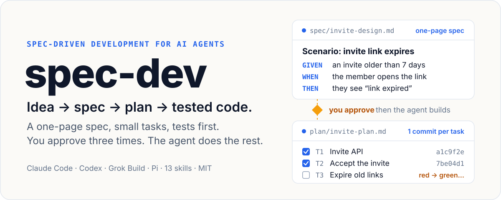
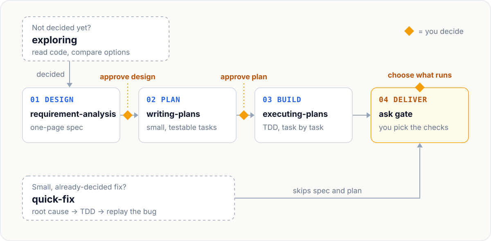
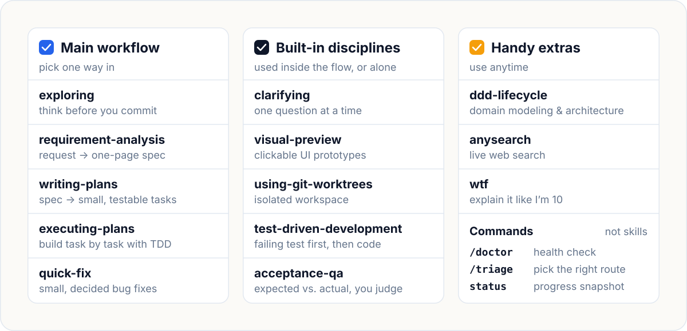

<p align="right">
  <strong>English</strong> · <a href="./README.zh-CN.md">简体中文</a>
</p>

<p align="center">
  
</p>

<p align="center">
  <a href="#install">Install</a> · <a href="#first-run">First run</a> · <a href="#skills">Skills</a> · <a href="#commands">Commands</a> · <a href="CHANGELOG.md">Changelog</a> · <a href="https://github.com/FlameMida/spec-dev/issues">Issues</a>
</p>

**spec-dev** is a plugin for AI coding agents: Claude Code, Codex, Grok Build, Pi, and any Agent Plugins host. It turns a request into a one-page spec, splits the spec into small tasks, and builds them one at a time, tests first, in an isolated worktree.

You stay in charge. The agent stops only three times: to approve the design, to approve the plan, and to let you choose what runs at the end (regression, acceptance, delivery). Anything you skip is reported as skipped, never as passed.

## How it works

<p align="center">
  
</p>

| Your situation | Start with |
|---|---|
| Not sure you should build it yet | `exploring` |
| A new feature or behavior change | `requirement-analysis` → `writing-plans` → `executing-plans` |
| A small bug you have already decided to fix | `quick-fix` |
| You already have a spec, or a plan | `writing-plans`, or `executing-plans` |
| Not sure which one | `/triage <your request>` |

Every skill also works on its own. Skills depend only on files inside `skills/`, so a skills-only install still runs the whole workflow.

<a id="install"></a>
## Install

You need a Git project, `git`, and **Node.js ≥ 18**. Install from the `dist` branch: it holds the packaged release, while `main` holds the sources.

**Claude Code** (run inside Claude Code)

```bash
/plugin marketplace add https://github.com/FlameMida/spec-dev.git#dist
/plugin install spec-dev@spec-agent-skills
```

**Codex** (run in a terminal)

```bash
codex plugin marketplace add https://github.com/FlameMida/spec-dev.git --ref dist
codex plugin add spec-dev@spec-agent-skills
```

Upgrade later with `codex plugin marketplace upgrade spec-agent-skills`. The plugin page lists four hooks; review and trust them yourself, because the plugin never grants trust automatically.

**Pi and Grok Build**

```bash
pi install git:github.com/FlameMida/spec-dev@dist
grok plugin install https://github.com/FlameMida/spec-dev.git@dist
```

In a Grok Build marketplace entry, use `source.ref: "dist"` instead of the `@dist` suffix.

**Other hosts:** use the ZIP, tar.gz, or npm package attached to each [GitHub Release](https://github.com/FlameMida/spec-dev/releases) (Agent Plugins 1.0.0 format), or copy the `skills/` folder into your host's skills directory.

Run `/doctor` to check the setup. Platform details and optional tools are under [More details](#more-details).

<a id="first-run"></a>
## First run

Just talk to your agent. The lines below are prompts, not shell commands; your host may also offer them as `/spec-dev:<skill>`.

**Build a feature end to end**

> Use requirement-analysis to design team-member invitations, including permissions, failure paths, and acceptance criteria.

The agent studies your code, asks one question at a time, then shows a design and a one-page spec draft. After you approve, it writes `.spec-dev/<date-NN-feature>/spec/<feature>-design.md` and continues to the plan. Approve the plan and it builds. When every task is done, it asks what to run.

**Explore before deciding**

> Use exploring to help me decide whether we need real-time collaboration. Compare polling and server push in this codebase. Don't implement anything yet.

**Fix a small bug**

> Use quick-fix to fix duplicate rows on the last pagination page. Find the root cause first, fix it with TDD, and replay the original request.

<a id="skills"></a>
## Skills

<p align="center">
  
</p>

### Main workflow

**`exploring`: think it through before you commit**<br>
Reads code and compares directions while you are still deciding. It is read-only by default, runs a small experiment only when you allow it, and never writes production code on its own.

> Use exploring to compare three ways to add audit logging and their trade-offs. We can stop once it's clear.

**`requirement-analysis`: turn a request into an approved one-page spec**<br>
For new features, APIs, data, and behavior changes. It explores, clarifies one question at a time, proposes a design, then writes the spec. You approve once. The spec holds the goal, non-goals, key decisions, and Requirements with GIVEN / WHEN / THEN scenarios.

> Use requirement-analysis to design tenant-level API keys: creation, rotation, revocation, permissions, and auditing.

**`writing-plans`: split the spec into small, testable tasks**<br>
Writes a single plan file: a header (goal, constraints, test commands, wrap-up choices), then tasks, each with its interfaces and TDD steps. Scenario names become test names. Approving the plan authorizes execution.

> Use writing-plans to turn .spec-dev/&lt;feature&gt;/spec/&lt;feature&gt;-design.md into an implementation plan.

**`executing-plans`: build the plan, task by task**<br>
Sets up an isolated worktree, then builds each task test-first, with one commit per task. After the last task it runs a light independent review and stops at the ask gate, where you choose regression, acceptance, and delivery (merge, PR, or keep the branch). An interrupted plan resumes from its checkboxes and the Git history.

> Use executing-plans to execute .spec-dev/&lt;feature&gt;/plan/&lt;feature&gt;-plan.md.

**`quick-fix`: fix a small, already-decided bug**<br>
Finds the root cause from evidence (including the related spec), confirms open points with you one at a time, repairs it with TDD, and replays the original symptom. If the fix crosses modules, needs a new dependency, or conflicts with a spec, it suggests switching to `requirement-analysis`.

> Use quick-fix to find out why the Save button sometimes stops responding, and fix it.

### Built-in disciplines (used inside the flow, or alone)

**`clarifying`: settle a decision one question at a time**<br>
Checks facts itself and asks only what truly needs you, one question at a time, each with a recommended answer. On its own it ends with a summary and a choice: continue into a workflow, stop, or save notes.

> Use clarifying to grill my offline-sync proposal until the goals and conflict rules are explicit.

**`visual-preview`: clickable UI prototypes in your browser**<br>
Starts automatically for new pages, redesigns, and major layout changes. It draws with your project's own stack and components, opens the prototype for you, and hands off a component mapping that the plan follows. With no frontend yet, it recommends a stack first.

> Use visual-preview to show two dashboard layouts side by side so I can pick one.

**`using-git-worktrees`: prepare an isolated workspace**<br>
Reuses existing isolation. Otherwise it creates a worktree under `.worktrees/` with `git worktree add` and installs dependencies. It does not run tests.

> Use using-git-worktrees to set up an isolated workspace for the billing feature.

**`test-driven-development`: failing test first, then code**<br>
Writes a behavior test at a public boundary, confirms it fails for the right reason, then writes the minimum code to pass. Compile errors, missing environments, and skipped tests count as neither red nor green, and committed assertions are never edited just to get green.

> Use test-driven-development to add expiry to password-reset links.

**`acceptance-qa`: expected vs. actual, you judge**<br>
Runs only when you call it or pick it at the ask gate. It builds a checklist from the scenarios and the actual changes, then shows expected and observed results side by side. It covers unit, integration, E2E, visual, a11y, web and API performance, and diagnosis. A missing tool means `unverified`, never a pass.

> Use acceptance-qa to check the cart page against its spec and approved prototype, including failure and permission-denied states.

### Handy extras

**`ddd-lifecycle`: domain-driven design in any language**<br>
Ubiquitous language, bounded contexts, entities, value objects, aggregates, domain events, repositories, hexagonal architecture, and ADRs. It won't force a rich model onto simple CRUD.

> Use ddd-lifecycle to define bounded contexts and aggregates for orders, payments, and refunds.

**`anysearch`: live web search without MCP**<br>
Web search, vertical search, parallel batch search, and page extraction through a bundled CLI. It works anonymously; `ANYSEARCH_API_KEY` only raises rate limits. Queries go to the AnySearch service, so keep secrets out of them.

> Use anysearch to find the current official docs on OAuth token rotation, citing primary sources.

**`wtf`: explain it like I'm 10**<br>
Explains a concept, code, or problem with 2–4 terminal diagrams and very little text. It reads the source first instead of guessing, and keeps the important conditions and failure paths.

> Use wtf to explain caching with terminal diagrams, including what happens when the cache and the database disagree.

<a id="commands"></a>
## Commands

These are not skills.

| Command | What it does |
|---|---|
| `/doctor` | Checks the platform, guardrail, hook injection, and anysearch health |
| `/triage <request>` | Recommends a route and writes nothing |
| `status` | Read-only snapshot of specs and plans across every worktree |

Run `status` from any project folder:

```bash
node "<absolute-plugin-directory>/scripts/status.mjs" --repo "/project/path" --json
```

Leave out `--repo` to use the current repository, or `--json` to get human-readable text. It runs offline and never re-runs acceptance.

## Optional: spec drift guard

A spec can declare the code it owns with `covers` in its frontmatter. The guardrail then blocks changes to that code that don't update the spec: at edit time, on commit and push, and in CI. Install it into your project:

```bash
node "/actual/plugin/directory/guardrail/install.mjs" --repo "/absolute/path/to/your/project"
```

The installer is idempotent. The default one-page spec has no frontmatter, so it is not guarded. If the Codex sandbox blocks writes to Git config, run the installer outside the sandbox. See the [guardrail guide](guardrail/README.md).

<a id="more-details"></a>
## More details

<details>
<summary><strong>Platforms and dependencies</strong></summary>

### Platform support

| Platform | Skills | Agents (subagents) | Hooks | Manifest / discovery |
|---|---|---|---|---|
| Claude Code | ✅ marketplace `skills[]` | ✅ generic subagents + briefs inside skills | ✅ plugin injection; guardrail install available | `.claude-plugin/` |
| Codex | ✅ directory auto-discovery | ✅ generic subagents + briefs inside skills | ✅ codex-hooks; trust required | `.codex-plugin/` |
| Grok Build | ✅ Claude-compatible (official claim) | ✅ same as Claude Code; behavior subject to actual acceptance | ⚠️ hook support differs; SessionStart does not inject model context, PostModelSwitch is unsupported | reuses `.claude-plugin/` |
| Pi | ✅ `package.json` `pi.skills` | ⚠️ requires the `pi-subagents` extension; otherwise the main thread does the work and says so | ❌ requires a separate TS extension adaptation | `package.json` |
| Agent Plugins 1.0.0 | ✅ root `plugin.json` + `skills/` | — outside the portable standard | — outside the portable standard | `plugin.json` |
| Skills only (copy or sync the `skills/` directory) | ✅ full workflow | depends on the host; otherwise the main thread does the work and says so | — no hooks, commands, or guard scripts | the host's own skills directory |

Skill text describes capabilities (asking the user, subagents, progress tools, isolated workspaces), never host-specific tool names. The mapping lives in [host compatibility](skills/requirement-analysis/references/host-compat.md). The portable packages keep the root `plugin.json`; the Git `dist` package omits it for Codex hook compatibility.

### Runtime dependencies

| Tier | Dependency | Used by | When missing |
|---|---|---|---|
| hard | `git` | drift guard, worktrees, per-task commits | main workflows unavailable |
| hard | Node.js ≥ 18 | contract validation, guardrail scripts, doctor, visual-preview, `node --test` | related validation and preview unavailable; degrade and report as documented |
| soft | `python3` | anysearch Python CLI | falls back to the zero-dependency Node CLI, then WebSearch / WebFetch |
| soft | ego-lite + official `ego-browser` skill | browser previews, page acceptance, and diagnosis | follow the official setup guide; affected browser checks remain `unverified` |
| soft | existing Playwright Test / k6 / Lighthouse | deterministic E2E and specialist checks | run applicable existing tools, or mark the row `unverified` |
| soft | `codex` CLI, `skill-creator` | repository development and release checks only | corresponding development checks skip softly |

For browser work, install [ego-lite and its official `ego-browser` skill](https://lite.ego.app/document/en/docs/quick-start), then run `ego-browser skill` and read the version-matched guide before operating the browser. spec-dev does not bundle that skill or register browser MCPs; see [browser setup](skills/acceptance-qa/references/browser-setup.md). Existing Playwright Test suites keep working on their own.

</details>

<details>
<summary><strong>Under the hood: why it works this way</strong></summary>

- **Process weight matches the problem.** Small fixes skip the paperwork, and features don't skip design. Decisions and findings carry over when you switch routes.
- **One contract from design to acceptance.** The spec describes observable behavior as Requirement + Scenario (GIVEN / WHEN / THEN). Scenarios become test names, and the final reconciliation and the acceptance checklist use the same contract. After delivery the spec is frozen as history and tests guard the behavior.
- **Three stops, no interruptions in between.** Design approval, plan approval, and the ask gate. Scope changes, deferrals, and contract-level deviations come back to you; reversible implementation details stay with the agent.
- **The plan is the source of truth.** Progress is the checkboxes in the plan file; deviations and the delivery choice go into its execution record. Recovery reads only the plan, the commits, and the workspace.
- **Verification moves forward.** Each task proves itself with valid red → green plus your existing typecheck and lint. One read-only subagent reviews at the end (two for large changes). Before delivery every Requirement is reconciled, and unfinished ones go to you to finish, defer, or drop.
- **From prototype to running page.** Approved prototypes are archived under `spec/assets/` with a component mapping. UI tasks carry their prototype screens and compare the built page with them once green. Outcomes mocked in a prototype still need real evidence.
- **Read-only subagents with briefs.** The explorer brief (`skills/requirement-analysis/references/explorer-brief.md`), external research brief (`skills/requirement-analysis/references/external-research-brief.md`), and reviewer brief (`skills/executing-plans/references/reviewer-brief.md`) ship with the skills. Without subagents, the main thread follows the same brief and says the work was not independent.
- **Thin skills, loaded on demand.** Each rule has one home, and templates and briefs load right before they are needed.
- **Honest degradation.** No external MCP is required. Browser work uses ego-lite through the official `ego-browser` skill; anysearch falls back from the Python CLI to the Node CLI, then to WebSearch / WebFetch. A missing tool yields `unverified`, never a pass.
- **Model-scoped extras.** When an enabled hook reports it, GPT / Codex and Kimi / Moonshot / GLM get extra goal-tracking and delivery-omission checks; Claude and unknown models do not. See the [model policy](guardrail/model-policy.md).

A typical artifact layout in your project:

```text
.spec-dev/
├── YYYY-MM-DD-NN-<feature>/
│   ├── spec/                 # one-page spec and approved assets
│   ├── plan/
│   │   └── <feature>-plan.md # header, navigation, task checkboxes, execution record
│   ├── visual/               # prototype sessions
│   └── acceptance/           # acceptance report and evidence (when used)
├── explorations/             # exploration / clarification notes saved with authorization
├── roadmaps/                 # multi-project routes and continuation state
├── glossary.md               # cross-feature domain terminology
└── adr/                      # architectural decisions worth preserving
```

Legacy `docs/` artifacts stay readable in place and are never migrated without explicit authorization.

</details>

<details>
<summary><strong>For maintainers: packaging, releases, evals, hooks, directory layout</strong></summary>

### Plugin package maintenance

The repository root is the plugin root, and runtime content has a single source tree. The two READMEs are maintained separately for English and Chinese. A release synchronizes five versions: `metadata.version` in `.claude-plugin/marketplace.json`, `.claude-plugin/plugin.json`, `.codex-plugin/plugin.json`, root `plugin.json`, and `package.json`.

With this repository's Git hooks installed, ordinary commits run static package, skill, metadata-sync, and staged-diff checks. They never change versions, amend commits, or create tags. Pre-push checks CHANGELOG coverage and remote tag conflicts. To release from a clean working tree, run `node scripts/release.mjs <patch|minor|major|X.Y.Z>` (add `--dry-run` to preview): it updates the five versions and CHANGELOG, runs `check-plugin.mjs --codex-validate`, then creates a separate release commit and annotated tag. The hook installer enables `push.followTags=true`, so a later push includes reachable annotated tags. The Codex check reports a skip if the CLI is unavailable.

```bash
# Manifest versions, skills[] versus disk, and symlink checks
node scripts/check-plugin.mjs

# Validate real Git-package installation and hook discovery in isolated Codex state
node scripts/check-plugin.mjs --codex-validate

# Validate every skill (including the SKILL.md UTF-8 size budget)
node scripts/validate-skills.mjs

# Build portable / Git packages; output must be a new directory outside the source checkout
node scripts/build-distribution.mjs --output /tmp/spec-dev-package
node scripts/build-distribution.mjs --output /tmp/spec-dev-git-package --format git
node --test scripts/tests/distribution.test.mjs
```

`package.json.files` is the shared distribution list. After a `v*` tag, `.github/workflows/distribution.yml` builds and updates `dist`, produces ZIP, tar.gz, and npm tgz artifacts, and creates the GitHub Release with those files attached and the matching CHANGELOG section as notes. Rebuilding identical output is a no-op; older versions or different content at the same version cannot overwrite the distribution.

### Maturity tiers and release discipline

Stable skills live under `skills/`. Claude Code reads the explicit `skills[]` list in `.claude-plugin/marketplace.json`, and `check-plugin.mjs` verifies it in both directions against the directories on disk. Codex auto-discovers directories, Pi reads `pi.skills`, and Agent Plugins reads the root manifest plus `skills/`.

- Experimental skills live in `skills-in-progress/<name>/`, are absent from every plugin manifest, and promise no stability.
- Graduation means moving into `skills/`, registering the marketplace entry, adding `agents/openai.yaml` and evals, and updating both READMEs plus the CHANGELOG.
- Orchestration follows the thin-shell convention: disciplines reference their single authoritative definition instead of copying it. Shared entry points include clarifying, the plan template, the explorer and reviewer briefs, and host compatibility.

### About evals

- `evals.json` is a **design-intent document** covering expected HARD-GATE, handoff, and degradation behavior, for human review and future evaluation harnesses. There is no general runner, so it is not an automated regression line.
- `trigger-evals.json` contains cold-startable, decidable trigger-surface cases (should-trigger / should-not-trigger and near-miss negatives), currently covering `acceptance-qa`, `clarifying`, `exploring`, `quick-fix`, `requirement-analysis`, `executing-plans`; connect them to an evaluation harness to run the verdicts.

Structural checks, document contracts, and real-model behavior evaluations are different kinds of evidence and cannot substitute for one another.

### Pre-commit hooks

Contributors can enable the versioned Git hooks:

```bash
node scripts/install-git-hooks.mjs
```

Commits then check the plugin package, skills, OpenAI metadata sync, and `git diff --cached --check`; a failed check aborts the commit. See `.githooks/` and the maintenance scripts for temporary skip switches and their limits.

### Directory Layout

```text
spec-dev/                            # repository root = plugin root
├── .claude-plugin/
│   ├── marketplace.json             # Claude marketplace and explicit skills[] list
│   └── plugin.json                  # Claude Code plugin manifest
├── .codex-plugin/plugin.json        # Codex plugin manifest
├── .agents/plugins/marketplace.json # Codex marketplace configuration
├── .githooks/                       # commit checks and release hooks
├── assets/readme/                   # README images (en / zh)
├── commands/                        # doctor / triage / status
├── guardrail/                       # spec drift guard installable into target repositories
├── hooks/                           # Claude / Codex lifecycle hooks
├── skills/
│   ├── exploring/                   # exploration before implementation commitment
│   ├── clarifying/                  # shared one-question-at-a-time clarification
│   ├── requirement-analysis/        # requirement design and specs
│   ├── visual-preview/              # browser HTML prototypes and approved archives
│   ├── ddd-lifecycle/               # DDD modeling, architecture, and ADRs
│   ├── writing-plans/               # verifiable tasks and implementation plans
│   ├── executing-plans/             # execution, recovery, review, and delivery
│   ├── using-git-worktrees/         # isolated-workspace discipline
│   ├── test-driven-development/     # valid red-green and refactor protection
│   ├── quick-fix/                   # lightweight diagnosis and repair
│   ├── acceptance-qa/               # acceptance, specialist testing, and diagnosis
│   ├── anysearch/                   # real-time search and page-extraction CLI
│   └── wtf/                         # plain-language terminal diagrams
├── scripts/
│   ├── check-plugin.mjs             # manifest, directory, and Codex installation checks
│   ├── validate-output.mjs          # generic JSON schema validation
│   ├── schemas/                     # vendored manifest schema
│   ├── validate-skills.mjs          # skill structure and size validation
│   ├── check-openai-sync.mjs        # openai.yaml synchronization check
│   ├── doctor.mjs                   # health diagnostics
│   ├── status.mjs                   # read-only cross-worktree progress snapshots
│   ├── update-vendored-skill.mjs    # sync vendored skills from upstream
│   ├── build-distribution.mjs       # build portable / Git distributions
│   └── release.mjs                  # release script
├── CHANGELOG.md
├── README.md                        # English
├── README.zh-CN.md                  # Simplified Chinese
└── LICENSE
```

</details>

---

**Author:** [FlameMida](https://github.com/FlameMida) · **License:** [MIT](LICENSE) · **History:** [CHANGELOG.md](CHANGELOG.md)

Issues and pull requests are welcome. For behavior changes, update the owning spec's Requirements in the same change and run the repository's tests and release checks.
