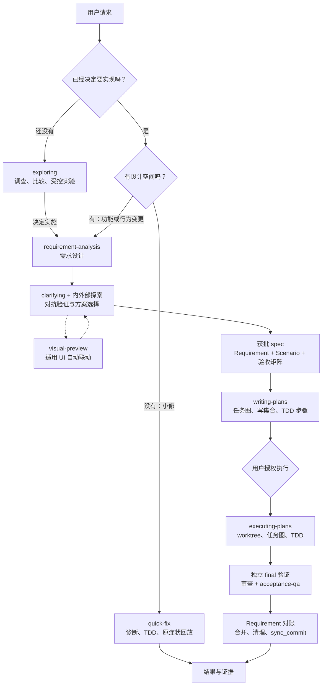

# spec-dev

**[English](README.md) | 简体中文**

> 从想法到设计，从设计到计划，再从计划到带证据的交付。

[更新日志](CHANGELOG.md) · [许可证](LICENSE) · [问题反馈](https://github.com/FlameMida/spec-dev/issues)

**spec-dev** 是一套面向 Claude Code、Codex、Grok Build、Pi 和通用 Agent Plugins 宿主的 spec 驱动开发插件。它把需求打磨为获批的 spec，把 spec 拆成可独立验证的任务图，再在隔离工作区中按 TDD 纪律实施，最后通过独立验证、审查、验收和 Requirement 对账完成交付。

它不是一个只能从头走到尾的刚性流程：14 个 skill 既可组成完整管线，也能单独调用。还没决定是否实施时使用 `exploring`；小 bug 使用 `quick-fix`；已有 spec 可从 `writing-plans` 进入；已有计划可直接交给 `executing-plans`。此外还提供 DDD 建模、浏览器原型、实时搜索和 `wtf` 终端图解。

<a id="overview"></a>
## 项目概览与整体工作流



三条主入口按“**是否已承诺实施**”和“**是否存在设计空间**”分流。`using-git-worktrees`、`test-driven-development`、`test-strategy` 等纪律由主流程复用；`anysearch`、`ddd-lifecycle` 和 `wtf` 也能独立使用。设计获批、计划获批和执行授权是不同决定，阅读文档或生成计划都不会自动开始实施。

<a id="navigation"></a>
## 快速导航

- **[快速开始](#quick-start)** — [安装](#install) · [首次使用](#first-run) · [平台支持](#platform-support) · [运行时依赖](#runtime-dependencies)
- **[Skill 使用指南](#skill-guide)** — [思考与设计](#design-skills) · [计划与执行](#delivery-skills) · [质量与修复](#quality-skills) · [检索与解释](#utility-skills)
- **[项目机制、优点与特点](#mechanics)** — 产物契约、审批边界、并行恢复、质量证据、漂移守卫、跨平台降级
- **参考** — [实用命令](#commands) · [维护与发布](#maintenance) · [目录结构](#directory-layout)

---

<a id="quick-start"></a>
## 快速开始

### 1.1 环境准备

完整开发管线建议具备：

- 一个受支持的 agent 宿主，以及一个 Git 项目；
- `git`：用于 worktree、任务提交、交付和漂移守卫；
- **Node.js ≥ 18**：用于契约校验、guardrail、doctor 和可视化预览服务；
- 浏览器、性能或 AI 自主验收工具按需安装，不是基础使用的前置条件。

> **安装分支请选择 `dist`。** `main` 是开发源码；`dist` 是由发布 tag 生成的可安装内容，不包含本仓库研发过程中产生的 `.spec-dev/` 档案。安装后，spec-dev 仍会正常读写**你的项目**自己的 `.spec-dev/`。

<a id="install"></a>
### 1.2 安装插件

#### Claude Code

在 Claude Code 中依次执行：

```bash
/plugin marketplace add https://github.com/FlameMida/spec-dev.git#dist
/plugin install spec-dev@spec-agent-skills
```

#### Codex

在终端执行：

```bash
codex plugin marketplace add https://github.com/FlameMida/spec-dev.git --ref dist
codex plugin add spec-dev@spec-agent-skills
```

新版本发布后运行 `codex plugin marketplace upgrade spec-agent-skills`。Codex 0.164.0 应使用上述 Git `dist` 入口；安装后插件页应显示 4 个 hooks，首次使用前需由你审阅并信任，插件不会自动授予信任。

#### Pi 与 Grok Build

```bash
# Pi
pi install git:github.com/FlameMida/spec-dev@dist

# Grok Build 直接安装
grok plugin install https://github.com/FlameMida/spec-dev.git@dist
```

Grok Build 也支持 marketplace 插件条目中的 `source.ref: "dist"`；不要把直接安装的 `@dist` 后缀机械套到 `grok plugin marketplace add` 的来源 URL 上。

#### 通用 Agent Plugins 1.0.0 包

通用宿主可消费分发工作流生成的 ZIP / tar.gz，npm 分发使用 `npm pack` 生成的 tgz。Agent Plugins 1.0.0 规定的是包格式，不定义统一 Git 安装命令；Git ref 的选择方式以具体宿主为准。便携包保留根级 `plugin.json`，Git `dist` 包则为 Codex hook 兼容性省略该文件。

<a id="first-run"></a>
### 1.3 首次使用：从一个真实需求开始

下面的示例都是**发给 agent 的自然语言**，不是终端 shell 命令，因此不依赖某一种宿主的调用前缀。也可以使用宿主界面显示的技能命令；带插件命名空间的宿主可能显示为 `/spec-dev:<skill>`。

#### 路线 A：完整功能交付

1. **设计需求**

   > 使用 requirement-analysis 为当前项目设计“团队成员邀请”功能，覆盖权限、失败路径和验收标准。

2. **审查并批准设计**。agent 会调查现状、逐题澄清、比较方案；只有你批准后才会写入 spec。典型位置为：

   ```text
   .spec-dev/<日期-序号-特性>/spec/<特性>-design.md
   ```

3. **生成实施计划**

   > 使用 writing-plans 把 .spec-dev/&lt;特性&gt;/spec/&lt;特性&gt;-design.md 拆成可独立验证的实施计划。

4. **审查计划并明确授权执行**

   > 使用 executing-plans 执行 .spec-dev/&lt;特性&gt;/plan/index.md。

5. **查看交付证据**。流程会完成任务实施、独立 final、审查、适用的 acceptance-qa、Requirement 对账和交付；不要把“计划已生成”或“部分测试通过”当作已经交付。

#### 路线 B：还没决定是否要做

> 使用 exploring 陪我评估当前项目是否需要实时协作，比较服务端推送和轮询，先不要实施。

#### 路线 C：已决定的小修

> 使用 quick-fix 修复分页最后一页重复数据的问题，先复现根因，再按 TDD 修复并回放原始请求。

不确定从哪条路进入时，可先使用 `/triage <需求>`；它只给出路由建议，不写文件，最终入口仍由你确认。

### 1.4 验证安装与可选漂移守卫

- 支持 commands 的宿主可运行 `/doctor`，检查平台、guardrail、注入标记、SessionStart hook 和 anysearch 健康态。
- 插件级 `hooks/hooks.json` 会在支持的宿主上自动注册会话上下文注入；**这不等于已安装完整漂移守卫**。
- 需要 PreToolUse / Stop、pre-commit / pre-push 和 CI 防线时，在目标项目安装 guardrail：

  ```bash
  node "/实际插件目录/guardrail/install.mjs" --repo "/你的项目绝对路径"
  ```

  安装器幂等；请替换为实际插件目录。Codex 沙箱若禁止写 Git 配置，应在沙箱外由用户运行安装器。详见 [guardrail 说明](guardrail/README.zh-CN.md)。

<a id="platform-support"></a>
### 1.5 平台支持

| 平台 | Skills | Agents（子代理） | Hooks | 清单 / 发现方式 |
|---|---|---|---|---|
| Claude Code | ✅ marketplace `skills[]` | ✅ `agents/*.md` | ✅ 插件注入；guardrail 可安装 | `.claude-plugin/` |
| Codex | ✅ 目录自动发现 | ⚠️ 通过派发提示词；`spawn_agent` 不读取 `agents/*.md` | ✅ codex-hooks，需信任 | `.codex-plugin/` |
| Grok Build | ✅ Claude 兼容（官方声明） | ✅ 同 Claude Code；字段行为以实际验收为准 | ⚠️ hook 支持有差异；SessionStart 不注入模型上下文，不支持 PostModelSwitch | 复用 `.claude-plugin/` |
| Pi | ✅ `package.json` 的 `pi.skills` | ⚠️ 需 `pi-subagents` 扩展 | ❌ 需另行适配 TS extension | `package.json` |
| Agent Plugins 1.0.0 | ✅ 根级 `plugin.json` + `skills/` | — 不在便携标准内 | — 不在便携标准内 | `plugin.json` |

<a id="runtime-dependencies"></a>
### 运行时依赖

| 分级 | 依赖 | 用途 | 缺失时 |
|---|---|---|---|
| hard | `git` | 漂移守卫、worktree、每任务提交、`sync_commit` 锚定 | 主流程不可用 |
| hard | Node.js ≥ 18 | 契约校验、guardrail、doctor、visual-preview、`node --test` | 相关校验与预览不可用，按约定降级并报告 |
| soft | `python3` | anysearch Python CLI | 降级到零依赖 Node CLI，再到 WebSearch / WebFetch |
| soft | Playwright / k6 / Lighthouse / 浏览器 MCP | 专项验收、Tier A 与性能检查 | 使用可用的 Tier D 工具链，或将对应项标为 `unverified` |
| soft | `codex` CLI、`skill-creator` | 仅本仓库开发与发布校验 | 对应开发检查软跳过 |

契约校验器无法运行时，主线程按 schema 人工核对必填键与 `coverage_note`，并在报告中注明“契约校验降级”；定义见 [探索与契约规则](skills/requirement-analysis/references/exploration-patterns.md)。macOS / Linux 的受控审查入口另需 Python 3.9+、已认证的本机 Claude CLI 和 rtk；这不影响其他平台使用原生工作流。

---

<a id="skill-guide"></a>
## Skill 使用指南

每个 skill 都能独立调用，也可以由主管线自动复用。以下每条示例都是可直接修改的自然语言提示词；若你的宿主提供 `/`、`$` 或其他技能调用语法，也可以换成对应形式。

<a id="design-skills"></a>
### 2.1 思考、澄清与设计

<a id="skill-exploring"></a>
#### `exploring` — 未承诺实施的探索伙伴

**用途：** 阅读代码、调查问题、比较方向，在还没有决定是否交付时保持开放。默认只读；确需运行才能回答的问题，可在明确授权后做隔离的受控 spike。探索不要求必须得出结论，也不会自动写生产代码或保存笔记。

**调用示例：**

> 使用 exploring 陪我判断这个项目是否需要实时协作，结合现有代码比较轮询与服务端推送，先不实施。

> 使用 exploring 探索审计日志的三种实现方向，记录各自前提和取舍；如果问题已经足够清楚，可以就此停止。

<a id="skill-clarifying"></a>
#### `clarifying` — 一次一题，把决策磨到共识

**用途：** 沿决策树澄清想法、计划或决定。能自查的事实由 agent 查证，真正需要你裁决的问题一次只问一个，并优先给出带推荐的互斥选项。独立调用以共识摘要和“转主流程 / 结束 / 写入 md”三个出口收束；被其他流程引用时不会额外套用这套出口。

**调用示例：**

> 使用 clarifying 逐题追问我的离线同步方案，直到目标、冲突规则和边界都达成明确共识。

> 使用 clarifying 检查这份计划还剩哪些真正需要我决定的事项；代码里能查到的事实不要反问我。

<a id="skill-requirement-analysis"></a>
#### `requirement-analysis` — 把已承诺需求变成获批 spec

**用途：** 适用于新功能、API、数据设计和有方案取舍的行为变更。按 light / standard / deep 调整调查深度，完成现状探索、逐题澄清、对抗验证、方案比较、完整设计批准、spec 落盘与审查，再交接 `writing-plans`。所有档位都保留设计批准 HARD-GATE。

**调用示例：**

> 使用 requirement-analysis 设计租户级 API Key，覆盖创建、轮换、吊销、权限和审计，并产出 spec。

> 使用 requirement-analysis 重新设计通知重试机制，先比较可行方案，不要在我批准设计前修改代码。

<a id="skill-visual-preview"></a>
#### `visual-preview` — 浏览器中的可交互 HTML 原型

**用途：** 展示 mockup、布局对比、图示和关键界面状态，让点击与选择回流到会话。新增页面、重设计、主要布局或核心交互变化时按契约自动启用；局部小改动可跳过，用户关闭后沿用该选择。视觉问题进浏览器，普通文字取舍仍留在对话中。

**调用示例：**

> 使用 visual-preview 在浏览器里并排展示两种仪表盘布局，让我点击选择并继续迭代。

> 使用 visual-preview 为项目列表页制作加载、空数据、错误和无权限四种状态的原型。

<a id="skill-ddd-lifecycle"></a>
#### `ddd-lifecycle` — 从领域建模到六边形架构

**用途：** 提供语言无关的 DDD 全流程规范：统一语言、限界上下文、实体 / 值对象 / 聚合、领域事件、仓储、Ports & Adapters、迁移和 ADR。既可用于新项目领域建模，也可用于日常 DDD 抉择和模型一致性审查；不会把限界上下文等同于微服务，也不要求简单 CRUD 使用重模型。

**调用示例：**

> 使用 ddd-lifecycle 为订单、支付和退款建立统一语言、划分限界上下文，并设计聚合边界。

> 使用 ddd-lifecycle 审查当前领域模型的依赖方向，判断哪些逻辑应移到 domain，以及哪些决策值得记录 ADR。

<a id="delivery-skills"></a>
### 2.2 计划、隔离与执行

<a id="skill-writing-plans"></a>
#### `writing-plans` — 把 spec 拆成可验证任务图

**用途：** 将获批 spec 或明确需求拆成 `index.md + tasks/ + progress.yaml`，写清接口、真实依赖、精确写集合、资源归属、TDD 步骤和验证命令。任务按可独立交付和审查的行为切片组织，而不是机械地按技术层排队；计划生成不等于执行授权。

**调用示例：**

> 使用 writing-plans 根据 .spec-dev/&lt;特性&gt;/spec/&lt;特性&gt;-design.md 编写实施计划，明确任务依赖和每票写集合。

> 使用 writing-plans 修订这份计划，把可以并行验证的切片拆开，并保留独立 final、验收和交付任务。

计划完成后会按[计划自检清单](skills/writing-plans/references/plan-review.md)检查粒度、依赖、契约和恢复信息，再由你决定开始执行还是先 review。

<a id="skill-executing-plans"></a>
#### `executing-plans` — 执行、恢复、审查并交付计划

**用途：** 执行已批准的书面计划。默认按依赖图把就绪任务派给独立 worktree 中的 implementer，主线程独占进度和集成；依赖、写集合或资源冲突时顺序推进。支持中断恢复、独立 final、按规模的审查、acceptance-qa、Requirement 对账、合并清理和 `sync_commit` 锚定。

**调用示例：**

> 使用 executing-plans 执行 .spec-dev/&lt;特性&gt;/plan/index.md，从任务 0 开始并按计划完成交付。

> 使用 executing-plans 恢复上次中断的计划；先核对 progress、工作区和已有证据，不要重做已完成任务。

<a id="skill-using-git-worktrees"></a>
#### `using-git-worktrees` — 准备隔离且可验证的工作区

**用途：** 先检测现有隔离；新建 worktree 始终放在项目根 `.worktrees/`，宿主原生工具能遵守目标路径时才优先，否则使用 `git worktree`。已有工作区保留原位置。负责目录安全检查、依赖就绪和基线测试，避免嵌套 worktree、污染当前分支或把既有测试失败误认为本次回归。

**调用示例：**

> 使用 using-git-worktrees 为账单功能准备隔离工作区，安装必要依赖并验证测试基线。

> 使用 using-git-worktrees 检查我当前是否已经处于隔离环境，不要重复创建 worktree。

<a id="quality-skills"></a>
### 2.3 修复、测试与验收

<a id="skill-quick-fix"></a>
#### `quick-fix` — 有证据的轻量修复

**用途：** 处理已经决定要修、没有设计空间的小 bug 或小调整。沿“根因诊断与 spec 反查 → 逐题校对 → TDD 修复 → 原症状回放”前进；跨 spec、跨模块、新依赖、契约冲突或证据不足时提议升级，而不是把小修当成绕过设计的后门。

**调用示例：**

> 使用 quick-fix 修复分页越界导致的重复记录，先取得真实失败信号，再修复并回放原始请求。

> 使用 quick-fix 诊断保存按钮偶发无响应的问题；保持轻量，但如果证据表明需要跨模块设计，请把升级选择交给我。

<a id="skill-test-driven-development"></a>
#### `test-driven-development` — 有效红到最小实现转绿

**用途：** 在获批的公共测试落点先写行为测试，实际运行并确认失败来自目标行为，再做最小实现并验证通过。编译错误、缺环境、零测试和 SKIP 不算有效红或通过证据；纯重构使用前后行为保护，既有实现的补测如实记录比较证据，不伪造测试先行历史。

**调用示例：**

> 使用 test-driven-development 为密码重置链接增加过期行为，从现有公共服务边界写失败测试开始。

> 使用 test-driven-development 修复这个校验 bug，保留有效红、最小实现和相关检查转绿的实际命令与结果。

<a id="skill-test-strategy"></a>
#### `test-strategy` — 把测试放到正确的执行时点

**用途：** 设计 fast / final / manual 三 Lane 测试策略，连接 spec 验收矩阵、计划任务和验收执行。强调先治理 flaky、再优化时长、最后考虑选择系统；区分替身测试与真实集成信心，并为 AI Agent 提供模型边界和分层测试骨架。

**调用示例：**

> 使用 test-strategy 为这份 spec 设计 fast、final、manual 三 Lane，并标明每条验收矩阵行的执行时机。

> 使用 test-strategy 检查当前测试方案：减少每任务重复全量运行，同时保留真实数据库集成和最终完整验证。

<a id="skill-acceptance-qa"></a>
#### `acceptance-qa` — 对照契约验收并补足证据

**用途：** 对功能、页面或 API 做验收与故障诊断。页面默认经过“核对依据与证据 → 对照实际页面 → 补验缺口并给结论”；后端按行为契约。支持 unit / integration / E2E / visual / a11y / perf-web / perf-api / diagnose / all，复用仍有效的工程证据，缺工具或缺条件时标 `unverified`，不把缺口变成通过。

**调用示例：**

> 使用 acceptance-qa 按 active spec 和定稿原型验收购物车页面，覆盖正常、失败和无权限状态，并列出剩余证据缺口。

> 使用 acceptance-qa perf-api 在已授权的预发环境压测订单接口，目标是 p95 小于 300 ms。

<a id="utility-skills"></a>
### 2.4 实时检索与终端图解

<a id="skill-anysearch"></a>
#### `anysearch` — 内嵌 CLI 的实时搜索与正文抽取

**用途：** 通用网页搜索、垂直领域检索、并行批量检索和 URL 正文抽取，无需 MCP。它是技能流程的首选外部搜索入口；垂直检索先发现子域与必填参数。支持匿名访问，`ANYSEARCH_API_KEY` 只用于更高速率上限；查询和 URL 会发送给 AnySearch 服务，不应提交敏感信息。

**调用示例：**

> 使用 anysearch 查找当前版本官方文档中关于 OAuth token rotation 的说明，优先引用一手来源并注明时效。

> 使用 anysearch 并行调研这三个独立主题，再抽取其中最相关文档的正文进行比较。

<a id="skill-wtf"></a>
#### `wtf` — 用终端图把问题讲明白

**用途：** 用 10 岁小孩也能理解的表达解释概念、代码、流程或问题，以 2–4 张有信息增量的终端字符图为主、少量短句为辅。降低理解门槛但不删掉关键条件和失败路径；解释代码、日志或文档时会先读原文，不靠猜测画图。

**调用示例：**

> 使用 wtf 用终端图解释缓存是什么、为什么更快，以及缓存和数据库不一致时会发生什么。

> 使用 wtf 阅读这个请求处理模块，用少量文字和几张图画出一次请求从入口到响应的全过程。

<a id="commands"></a>
### 2.5 实用命令（不属于上述 14 个 skill）

| 入口 | 用途 | 示例 |
|---|---|---|
| `/doctor` | 检查平台、守卫、hook 注入和 anysearch 健康态 | `/doctor` |
| `/triage` | 按承诺状态、任务类型和设计空间建议入口，全程零落盘 | `/triage 帮我决定这个请求该走哪条流程` |
| `status` | 汇总同一 Git 仓库各 worktree 的 roadmap、spec 和计划记录 | 见下方 CLI |

状态快照可从项目任意子目录运行：

```bash
node "<插件绝对目录>/scripts/status.mjs" --repo "/项目路径" --json
```

`--repo` 可省略以自动识别当前仓库，`--json` 可省略以输出人类可读文本。该命令只读、离线运行，保留不同 worktree 的来源和分歧；它不会重新验收，也不会核验交付事实。

---

<a id="mechanics"></a>
## 项目机制、优点与特点

### 3.1 分诊机制：流程重量与问题复杂度匹配

**机制：** 入口按承诺状态、任务类型和设计空间选择 `exploring`、`quick-fix`、`requirement-analysis` 或报告通道；大小拿不准的已承诺修复可从 quick-fix 起步，再根据证据决定是否升级。已有决定和探索证据会随交接复用。

**优点：** 不为小修堆砌文书，也不让复杂功能跳过设计；减少重复提问、重复调查和“选错流程后从头再来”。

### 3.2 Spec 契约：让设计、代码、测试与验收说同一种语言

**机制：** spec 使用 **Requirement + Scenario（GIVEN / WHEN / THEN）** 描述可观察行为，验收矩阵记录必需程度、D / A / X 执行性质和 fast / final / manual 时机。`writing-plans` 把 Scenario 翻译为验证步骤，`executing-plans` 与 `acceptance-qa` 再按同一份契约核对结果。spec frontmatter 的 `covers`、`status`、`superseded_by` 和 `sync_commit` 管理覆盖范围与生命周期。

**优点：** 降低“需求写的是 A、实现做成 B、测试却验证 C”的翻译损耗；变更、取代、延期和放弃都有可追踪记录，而不是只存在于对话里。

典型产物结构：

```text
.spec-dev/
├── YYYY-MM-DD-NN-<特性>/
│   ├── spec/                 # 设计、行为规范、验收矩阵、定稿资源
│   ├── plan/
│   │   ├── index.md          # 全局约束、接口与任务导航
│   │   ├── tasks/            # 独立任务、final、验收与交付
│   │   └── progress.yaml     # 唯一运行状态与资源台账
│   ├── visual/               # 原型会话
│   └── acceptance/           # 验收报告与证据索引
├── explorations/             # 经授权保存的探索 / 澄清笔记
├── roadmaps/                 # 多子项目路线与续接状态
├── glossary.md               # 跨特性领域术语
└── adr/                      # 有留痕价值的架构决策
```

旧 `docs/` 产物按原位读取；没有明确授权不会自动迁移。安装包排除插件仓库自己的研发档案，不影响用户项目的 `.spec-dev/`。

### 3.3 审批与授权边界：自动化不等于替用户做决定

**机制：** 探索与设计阶段默认不写生产代码；完整设计获批后才生成 spec，计划编写需要明确同意，执行计划还需执行授权。契约级偏差、范围扩大、延期或放弃会回到用户裁决；普通可逆实现细节则由 agent 在既定范围内处理。

**优点：** 把人的决定保留在方向、范围和重要取舍上，同时避免每个文件操作都打断一次。设计确认、原型局部选择、计划认可与执行许可不会相互冒充。

### 3.4 任务图与隔离执行：默认并行，但不牺牲可恢复性

**机制：** 计划声明真实依赖、精确 writes、共享资源和可独立验证边界。执行时就绪任务默认派给独立 worktree 中的 implementer，主线程统一管理 claim、progress、集成和交付；依赖或资源冲突时自动收敛为串行。`progress.yaml` 是唯一运行状态源，恢复时核对已提交状态、实际工作区与原始证据。

**优点：** 能并行的任务不必排队，不能并行的任务不会互相覆盖；中断后从真实状态续接，而不是凭聊天印象重做。资源台账还使容器、临时目录和测试数据的清理有据可查。

### 3.5 证据驱动的质量链：测试绿不是终点

**机制：**

- `test-driven-development` 要求有效红、最小实现和真实绿，区分行为测试、重构保护与补测证据；
- `test-strategy` 将每任务快检、独立 final 全量和需特殊条件的 manual 检查分开；
- 实施完成后先取得独立 final，再按规模组织 1 / 2 / 5 路审查，必要时追加 completeness critic；
- `acceptance-qa` 使用确定性 D、AI 自主 A 和诊断 X 检查，结论可为 `pass / warn / fail / unverified`；
- 交付前逐条 Requirement 对账为 DELIVERED / DEFERRED / DROPPED / SUPERSEDED，并记录执行中获批新增的 ADDED-IN-FLIGHT。

**优点：** 测试、审查和验收各自回答不同问题；失败、未验证和未覆盖不会被“总体看起来没问题”吞掉。修复后只按影响补验并复用仍有效证据，同时保留新候选所需的复审。

### 3.6 原型到运行的视觉闭环

**机制：** `visual-preview` 用本地服务展示版本化 HTML，浏览器事件带屏幕版本回流；采用的定稿与资源归档进 `spec/assets/`。实施形成第一条真实用户闭环时即对照原型，验收时再按相同角色、数据、操作、视口和状态检查实际页面。

**优点：** 设计阶段看到的不只是文字想象，交付阶段也不会只凭一张截图宣布成功。模拟在原型里的保存、价格和权限结果，仍需真实业务证据支撑。

### 3.7 契约化多代理协作：角色清楚，输出可校验

| Agent | 职责 | 主要使用位置 |
|---|---|---|
| `code-explorer` | 只读代码分析、调用链与影响面调查 | 需求探索、根因调查 |
| `external-resource-explorer` | 外部资料调研与一手来源证据 | 需求设计与回补探索 |
| `code-reviewer` | 独立代码审查与 spec 符合性检查 | 收尾审查 |
| `implementer` | 在独立 worktree 中完成认领任务的 TDD 与自检 | `executing-plans` |

子代理结果按 JSON Schema 契约校验；`validate-output.mjs` 失败时退回补全一次，再失败由主线程接管或明确降级。探索与审查保持只读，implementer 只写已认领范围。

**优点：** 并行不会模糊责任边界，结构化回执比散文式“已完成”更容易检查；能力缺失时可以降级，但不能伪造独立审查或不存在的工具结果。

### 3.8 Spec 漂移守卫：把同步义务变成分层防线

**机制：** active spec 的 `covers` 声明它拥有的代码。变更命中覆盖范围却未同步对应 spec 时，guardrail 可在编辑、收尾、提交、推送和 CI 层拦截；任务绑定进一步核对当前任务、spec、写集合与工作区。`sync_commit` 是交付后的同步锚点，不替代测试或行为审查。

**优点：** 文档不再只靠开发者记得更新，换编辑工具也有 Git 和 CI 防线；守卫检查范围与同步事实，测试和审查继续负责行为是否正确。完整安装方式与临时放行边界见 [guardrail 文档](guardrail/README.zh-CN.md)。

### 3.9 薄壳 Skill 与渐进加载：规则只有一份，需要时才展开

**机制：** 编排 skill 只负责流程，澄清、TDD、测试策略、计划格式、资源台账等纪律各有一个权威定义点；详细模板、恢复协议和平台适配在动作发生前按需加载。所有发现方式都指向同一个 `skills/` 目录。

**优点：** 避免多个流程复制规则后彼此漂移，减少无关上下文占用；单个 skill 可独立复用，完整管线又共享一致约束。文件变短或结构校验通过只证明结构，不会被当作真实模型效果提升的证据。

### 3.10 跨平台与可降级设计：主流程不强制外部 MCP

**机制：** Claude Code / Grok Build 使用 Claude 清单，Codex 自动发现技能目录，Pi 与 Agent Plugins 使用各自清单。基础流程不要求外部 MCP；浏览器自动化 MCP 和性能工具按项目选择。AnySearch 是可降级的联网搜索服务，Python CLI 不可用时切换零依赖 Node CLI，再按规则降级到 WebSearch / WebFetch。工具、授权或环境缺失会记录降级或 `unverified`。

**优点：** 同一套核心产物和工作纪律可跨宿主使用，增强能力按需接入；缺工具时仍能安全完成可完成的部分，但不会把未执行检查写成通过。

### 3.11 按实际模型启用协作增强

**机制：** 在 hook 已启用并明确返回状态时，GPT / Codex、Kimi / Moonshot / GLM 可加载目标保持、必要工作检查、决策筛选、恢复和交付遗漏检查；Claude 与未知模型不启用。判断依据是当前代理的实际模型，而不是宿主名称；子代理不会仅因父代理启用就继承增强。

**优点：** 为不同模型补充一致的执行纪律，同时不改变既有审批门、任务范围或用户授权。别名、开关与宿主限制见[模型策略](guardrail/model-policy.md)。

---

<a id="maintenance"></a>
## 维护与发布参考

### 插件包维护

仓库根即插件根，运行内容只有一份源码；两个 README 分别维护中英文，无额外镜像目录。发版需同步五处版本号：`.claude-plugin/marketplace.json` 的 `metadata.version`、`.claude-plugin/plugin.json`、`.codex-plugin/plugin.json`、根级 `plugin.json` 和 `package.json`。

```bash
# 清单版本、skills[] 与磁盘目录、符号链接检查
node scripts/check-plugin.mjs

# 使用隔离 Codex 状态验证真实 Git 包安装与 hooks 发现
node scripts/check-plugin.mjs --codex-validate

# 校验所有 skill（另含 SKILL.md UTF-8 体积预算）
node scripts/validate-skills.mjs

# 构建便携包 / Git 包；输出必须是源码仓库外的新目录
node scripts/build-distribution.mjs --output /tmp/spec-dev-package
node scripts/build-distribution.mjs --output /tmp/spec-dev-git-package --format git
node --test scripts/tests/distribution.test.mjs
```

`package.json.files` 是共享分发清单；`.github/workflows/distribution.yml` 在 `v*` tag 后构建并更新 `dist`，生成 ZIP、tar.gz 和 npm tgz 工作流附件。相同产物重复构建不产生提交，旧版本或同版本不同内容不能覆盖。

### 成熟度分区与发布纪律

正式 skill 全部位于 `skills/`。Claude Code 读取 `.claude-plugin/marketplace.json` 中显式 `skills[]` 清单，`check-plugin.mjs` 与磁盘目录做双向校验；Codex 自动发现目录，Pi 读取 `pi.skills`，Agent Plugins 读取根清单与 `skills/`。

- 实验 skill 放在 `skills-in-progress/<name>/`，不进入任何插件清单，也不承诺稳定。
- 毕业时需要移入 `skills/`、登记 marketplace、补充 `agents/openai.yaml` 与 evals、更新双语 README 和 CHANGELOG。
- 编排层遵循“薄壳委托”：纪律引用权威定义，不复制出第二套规则；共享入口包括 clarifying、计划格式、探索契约、验收矩阵与测试 Lane。

### evals 定位

- `evals.json` 是**设计意图文档**，记录 HARD-GATE、交接门和降级路径等预期行为，供人工审查与未来评测 harness 使用；仓库没有通用运行器，它不构成自动化回归防线。
- `trigger-evals.json` 是可冷启动、可判定的触发面用例（should-trigger / should-not-trigger 与 near-miss 负例），目前覆盖 `acceptance-qa`、`clarifying`、`exploring`、`quick-fix`、`requirement-analysis`、`test-strategy`、`executing-plans` 七个 skill，可接入评测 harness 运行。

结构检查、文档契约与真实模型行为评测是不同证据，不能互相替代。

### 提交前 hooks

本仓库贡献者可启用版本化 Git hooks：

```bash
node scripts/install-git-hooks.mjs
```

启用后，提交前会检查真实 Codex 安装、skills、OpenAI 元数据同步和 `git diff --cached --check`。校验失败会中止提交；临时跳过方式及适用边界见 `.githooks/` 与维护脚本说明。

<a id="directory-layout"></a>
## 目录结构

```text
spec-dev/                            # 仓库根即插件根
├── .claude-plugin/
│   ├── marketplace.json             # Claude marketplace 与显式 skills[] 清单
│   └── plugin.json                  # Claude Code 插件清单
├── .codex-plugin/plugin.json        # Codex 插件清单
├── .agents/plugins/marketplace.json # Codex marketplace 配置
├── .githooks/                       # 提交校验与发布 hooks
├── agents/                          # 4 个专门化 agents
├── commands/                        # doctor / triage / status
├── guardrail/                       # 可安装到目标仓库的 spec 漂移守卫
├── hooks/                           # Claude / Codex 生命周期 hooks
├── skills/
│   ├── exploring/                   # 未承诺实施的探索
│   ├── clarifying/                  # 一次一题的共享澄清纪律
│   ├── requirement-analysis/        # 需求设计与 spec
│   ├── visual-preview/              # 浏览器 HTML 原型与定稿归档
│   ├── ddd-lifecycle/               # DDD 建模、架构与 ADR
│   ├── writing-plans/               # 可验证任务图与实施计划
│   ├── executing-plans/             # 执行、恢复、审查与交付
│   ├── using-git-worktrees/         # 隔离工作区纪律
│   ├── test-driven-development/     # 有效红绿与重构保护
│   ├── test-strategy/               # fast / final / manual 测试策略
│   ├── quick-fix/                   # 轻量诊断与修复
│   ├── acceptance-qa/               # 验收、专项测试与诊断
│   ├── anysearch/                   # 实时搜索与正文抽取 CLI
│   └── wtf/                         # 大白话终端图解
├── scripts/
│   ├── check-plugin.mjs             # 清单、目录与 Codex 安装校验
│   ├── validate-output.mjs          # 输出契约与 plan-index 校验
│   ├── schemas/                     # 4 类输出契约 schema + 1 个 vendored manifest schema
│   ├── validate-skills.mjs          # skill 结构与体积校验
│   ├── check-openai-sync.mjs        # openai.yaml 同步检查
│   ├── doctor.mjs                   # 健康诊断
│   ├── status.mjs                   # 跨 worktree 只读进度快照
│   ├── update-vendored-skill.mjs    # 同步上游 vendored skill
│   ├── build-distribution.mjs       # 构建便携 / Git 分发包
│   └── release.mjs                  # 发布脚本
├── CHANGELOG.md
├── README.md                        # English
├── README.zh-CN.md                  # 简体中文
└── LICENSE
```

---

**作者：** [FlameMida](https://github.com/FlameMida) · **许可证：** [MIT](LICENSE) · **详细历史：** [CHANGELOG.md](CHANGELOG.md)

欢迎提交 Issue 和 Pull Request。行为变更请同时更新所属 spec 的需求与验收矩阵，并遵循仓库的测试和发布校验。
