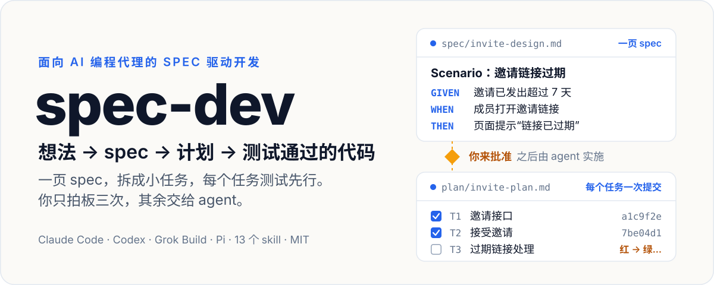
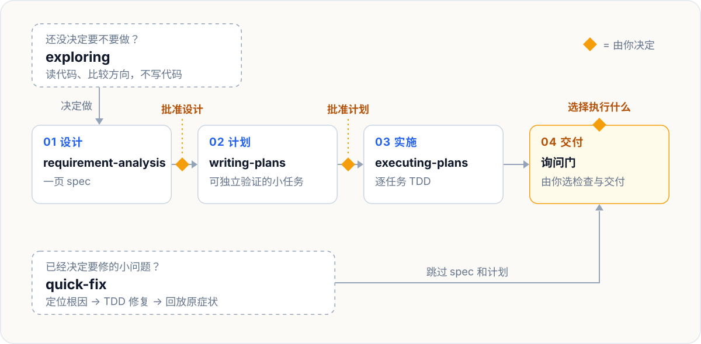
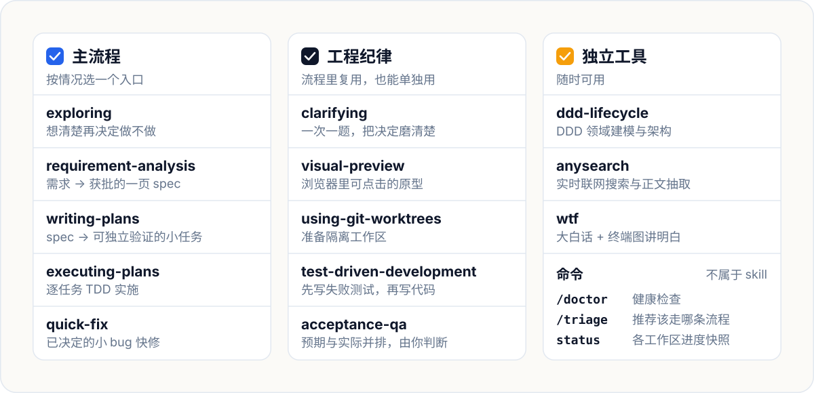

<p align="right">
  <a href="./README.md">English</a> · <strong>简体中文</strong>
</p>

<p align="center">
  
</p>

<p align="center">
  <a href="#install">安装</a> · <a href="#first-run">上手</a> · <a href="#skills">Skill 介绍</a> · <a href="#commands">命令</a> · <a href="CHANGELOG.md">更新日志</a> · <a href="https://github.com/FlameMida/spec-dev/issues">问题反馈</a>
</p>

**spec-dev** 是一个给 AI 编程代理用的插件，支持 Claude Code、Codex、Grok Build、Pi 和通用 Agent Plugins 宿主。它把需求打磨成一页 spec，再拆成小任务，在隔离的 worktree 里逐个任务、测试先行地实现。

主导权始终在你手里。agent 只停下来问你三次：批准设计、批准计划、最后选择要跑什么（回归、验收、交付）。你没选的项会如实标为“未执行”，不会被算成通过。

## 怎么运作

<p align="center">
  
</p>

| 你的情况 | 从这里开始 |
|---|---|
| 还没决定要不要做 | `exploring` |
| 新功能或行为变更 | `requirement-analysis` → `writing-plans` → `executing-plans` |
| 已经决定要修的小 bug | `quick-fix` |
| 已经有 spec，或已经有计划 | `writing-plans`，或 `executing-plans` |
| 不确定该走哪条 | `/triage <你的需求>` |

每个 skill 都能单独使用。skill 只依赖 `skills/` 目录里的文件，只装 skills 也能完整走完流程。

<a id="install"></a>
## 安装

需要一个 Git 项目、`git` 和 **Node.js ≥ 18**。请从 `dist` 分支安装：`dist` 是打包好的发布版，`main` 是开发源码。

**Claude Code**（在 Claude Code 里运行）

```bash
/plugin marketplace add https://github.com/FlameMida/spec-dev.git#dist
/plugin install spec-dev@spec-agent-skills
```

**Codex**（在终端运行）

```bash
codex plugin marketplace add https://github.com/FlameMida/spec-dev.git --ref dist
codex plugin add spec-dev@spec-agent-skills
```

之后升级用 `codex plugin marketplace upgrade spec-agent-skills`。插件页会列出 4 个 hook，请自行审阅并信任；插件不会自动授予信任。

**Pi 与 Grok Build**

```bash
pi install git:github.com/FlameMida/spec-dev@dist
grok plugin install https://github.com/FlameMida/spec-dev.git@dist
```

Grok Build 的 marketplace 条目请用 `source.ref: "dist"`，不要照搬直装时的 `@dist` 后缀。

**其他宿主：** 使用每个 [GitHub Release](https://github.com/FlameMida/spec-dev/releases) 附带的 ZIP、tar.gz 或 npm 包（Agent Plugins 1.0.0 格式），或者直接把 `skills/` 目录复制到宿主的 skills 目录。

装好后运行 `/doctor` 检查环境。平台细节与可选工具见[更多细节](#more-details)。

<a id="first-run"></a>
## 上手

直接跟 agent 说话就行。下面是给 agent 的提示词，不是 shell 命令；你的宿主也可能把它们显示为 `/spec-dev:<skill>`。

**完整做一个功能**

> 使用 requirement-analysis 为这个项目设计团队成员邀请功能，包括权限、失败路径和验收标准。

agent 会先读代码，一次只问一个问题，然后给出设计和一页 spec 草稿。你批准后，它写入 `.spec-dev/<日期-序号-特性>/spec/<特性>-design.md` 并继续编写计划。批准计划后开始实施；全部任务完成后，再问你要跑什么。

**先探索，再决定**

> 使用 exploring 陪我判断这个项目是否需要实时协作，结合现有代码比较轮询与服务端推送，先不实施。

**修一个小 bug**

> 使用 quick-fix 修复分页最后一页出现重复数据的问题：先找到根因，再用 TDD 修复，并回放原始请求。

<a id="skills"></a>
## Skill 介绍

<p align="center">
  
</p>

### 主流程

**`exploring`：想清楚，再决定做不做**<br>
在还没决定交付时读代码、比较方向。默认只读；只有你同意时才做小实验，也不会自己写生产代码。

> 使用 exploring 比较审计日志的三种实现方向和各自取舍；问题清楚了就可以停。

**`requirement-analysis`：把需求变成获批的一页 spec**<br>
适合新功能、API、数据设计和行为变更。流程是：理解与探索、逐题澄清、设计提案、写入 spec，你只需批准一次。spec 包含目标、非目标、关键决策，以及用 GIVEN / WHEN / THEN 描述的 Requirement 与 Scenario。

> 使用 requirement-analysis 设计租户级 API Key，覆盖创建、轮换、吊销、权限和审计。

**`writing-plans`：把 spec 拆成可验证的小任务**<br>
产出一份计划文件：头部写目标、约束、测试命令和收尾选择，后面是各个任务及其接口和 TDD 步骤。Scenario 名直接成为测试名。批准计划即授权执行。

> 使用 writing-plans 把 .spec-dev/&lt;特性&gt;/spec/&lt;特性&gt;-design.md 拆成实施计划。

**`executing-plans`：按计划逐任务实施**<br>
先准备隔离 worktree，再逐个任务测试先行地实现，每个任务一次提交。最后一个任务完成后做一次轻量独立审查，然后停在询问门：回归、验收和交付方式（本地合并、PR 或保留分支）都由你选。中断后按计划复选框和 git 记录续接。

> 使用 executing-plans 执行 .spec-dev/&lt;特性&gt;/plan/&lt;特性&gt;-plan.md。

**`quick-fix`：修已经决定要修的小 bug**<br>
按证据定位根因（含反查相关 spec），逐题与你校对，用 TDD 修复，并回放原症状。如果发现要跨模块、加新依赖或与现有 spec 冲突，会提议升级到 `requirement-analysis`。

> 使用 quick-fix 查清保存按钮偶尔没反应的原因并修好。

### 工程纪律（流程里复用，也能单独用）

**`clarifying`：一次一题，把决定磨清楚**<br>
能自己查的事实自己查，只问真正需要你拍板的事，一次一个，并附推荐答案。单独使用时以共识摘要收尾，再让你选：转入主流程、就此结束，或写成笔记。

> 使用 clarifying 逐题追问我的离线同步方案，直到目标和冲突规则都明确。

**`visual-preview`：浏览器里可点击的原型**<br>
新增页面、重设计、主要布局或核心交互变化时自动启用。按项目自己的技术栈和组件绘制，主动打开给你看，并交接一张组件映射表供计划实施使用。项目还没有前端时，会先推荐技术栈。

> 使用 visual-preview 在浏览器里并排展示两种仪表盘布局，让我点选一个。

**`using-git-worktrees`：准备隔离工作区**<br>
已有隔离就沿用；否则用 `git worktree add` 在 `.worktrees/` 下新建，并装好依赖。不运行测试。

> 使用 using-git-worktrees 为账单功能准备一个隔离工作区。

**`test-driven-development`：先写失败测试，再写代码**<br>
在公共边界写行为测试，确认它因为目标行为而失败，再写最少的代码让它通过。编译错误、缺环境和跳过的测试既不算红也不算绿；已提交的断言不会为了转绿而修改。

> 使用 test-driven-development 为密码重置链接加上过期行为。

**`acceptance-qa`：预期与实际并排，由你判断**<br>
只在你直接调用，或在询问门选中时运行。按 Scenario 和实际改动生成验收清单，每一项并排给出预期与实际结果。支持单元、集成、E2E、视觉、可访问性、Web 与接口性能以及故障诊断。缺工具就标 `unverified`，绝不算通过。

> 使用 acceptance-qa 按 spec 和定稿原型验收购物车页面，包括失败和无权限状态。

### 独立工具

**`ddd-lifecycle`：语言无关的 DDD 指南**<br>
覆盖统一语言、限界上下文、实体、值对象、聚合、领域事件、仓储、六边形架构和 ADR。不会给简单 CRUD 强加重模型。

> 使用 ddd-lifecycle 为订单、支付和退款划分限界上下文并设计聚合。

**`anysearch`：不需要 MCP 的实时搜索**<br>
通过内置 CLI 做网页搜索、垂直领域检索、并行批量检索和网页正文抽取。可匿名使用，`ANYSEARCH_API_KEY` 只用于提高速率上限。查询会发送给 AnySearch 服务，请勿包含敏感信息。

> 使用 anysearch 查找 OAuth token rotation 的最新官方文档，优先引用一手来源。

**`wtf`：讲到 10 岁小孩也能懂**<br>
用 2–4 张终端字符图加少量文字解释概念、代码或问题。先读原文再画图，不靠猜，也不删掉关键条件和失败路径。

> 使用 wtf 用终端图解释缓存，包括缓存和数据库不一致时会发生什么。

<a id="commands"></a>
## 命令

以下命令不属于 skill。

| 命令 | 作用 |
|---|---|
| `/doctor` | 检查平台、守卫、hook 注入和 anysearch 健康状态 |
| `/triage <需求>` | 推荐该走哪条流程，不写任何文件 |
| `status` | 只读汇总所有 worktree 里的 spec 与计划进度 |

在项目任意目录运行 `status`：

```bash
node "<插件绝对目录>/scripts/status.mjs" --repo "/项目路径" --json
```

省略 `--repo` 会自动识别当前仓库，省略 `--json` 则输出人类可读文本。它离线运行，不会重新验收。

## 可选：spec 漂移守卫

spec 可以在 frontmatter 里用 `covers` 声明自己负责的代码。守卫会在编辑、提交、推送和 CI 时拦下“改了这些代码却没同步 spec”的变更。安装到你的项目：

```bash
node "/实际插件目录/guardrail/install.mjs" --repo "/你的项目绝对路径"
```

安装器可以重复运行。默认的一页 spec 不带 frontmatter，不参与守卫。如果 Codex 沙箱禁止写 Git 配置，请在沙箱外运行安装器。详见 [guardrail 文档](guardrail/README.zh-CN.md)。

<a id="more-details"></a>
## 更多细节

<details>
<summary><strong>平台与依赖</strong></summary>

### 平台支持

| 平台 | Skills | Agents（子代理） | Hooks | 清单 / 发现方式 |
|---|---|---|---|---|
| Claude Code | ✅ marketplace `skills[]` | ✅ 通用子代理 + skill 内 brief | ✅ 插件注入；可安装 guardrail | `.claude-plugin/` |
| Codex | ✅ 目录自动发现 | ✅ 通用子代理 + skill 内 brief | ✅ codex-hooks；需要信任 | `.codex-plugin/` |
| Grok Build | ✅ 兼容 Claude（官方声明） | ✅ 与 Claude Code 相同；以实际验收为准 | ⚠️ hook 支持有差异；SessionStart 不注入模型上下文，不支持 PostModelSwitch | 复用 `.claude-plugin/` |
| Pi | ✅ `package.json` `pi.skills` | ⚠️ 需要 `pi-subagents` 扩展；否则由主线程完成并注明 | ❌ 需要单独的 TS 扩展适配 | `package.json` |
| Agent Plugins 1.0.0 | ✅ 根级 `plugin.json` + `skills/` | — 不在便携标准内 | — 不在便携标准内 | `plugin.json` |
| 只装 skills（复制或同步 `skills/` 目录） | ✅ 流程完整可用 | 取决于宿主；没有则由主线程完成并注明 | — 无 hooks、命令与守卫脚本 | 宿主自己的 skills 目录 |

各 skill 正文按能力描述（提问、子代理、进度工具、隔离工作区），不写宿主专有的工具名；具体映射见[宿主适配](skills/requirement-analysis/references/host-compat.md)。便携包保留根级 `plugin.json`；Git `dist` 包为兼容 Codex hooks 不含该文件。

### 运行时依赖

| 分级 | 依赖 | 用途 | 缺失时 |
|---|---|---|---|
| hard | `git` | 漂移守卫、worktree、每任务提交 | 主流程不可用 |
| hard | Node.js ≥ 18 | 契约校验、guardrail、doctor、visual-preview、`node --test` | 相关校验与预览不可用，按约定降级并报告 |
| soft | `python3` | anysearch Python CLI | 降级到零依赖 Node CLI，再到 WebSearch / WebFetch |
| soft | ego-lite + 官方 `ego-browser` skill | 浏览器预览、页面验收和诊断 | 按官方指引接入；受影响的浏览器项标为 `unverified` |
| soft | 项目已有 Playwright Test / k6 / Lighthouse | 确定性 E2E 与专项检查 | 使用适用的既有工具，或将对应项标为 `unverified` |
| soft | `codex` CLI、`skill-creator` | 仅本仓库开发与发布校验 | 对应开发检查软跳过 |

浏览器任务需安装 [ego-lite 及官方 `ego-browser` skill](https://lite.ego.app/document/en/docs/quick-start)，操作前运行 `ego-browser skill` 并读取与当前版本匹配的指南。本插件不内嵌该 skill，也不注册浏览器 MCP；详见[浏览器接入](skills/acceptance-qa/references/browser-setup.md)。项目已有的 Playwright Test 测试照常可用。

</details>

<details>
<summary><strong>背后的机制：为什么这样设计</strong></summary>

- **流程轻重与问题匹配。** 小修不堆文书，复杂功能不跳过设计；换流程时，已有的决定和调查结果会一并带过去。
- **从设计到验收只有一份契约。** spec 用 Requirement + Scenario（GIVEN / WHEN / THEN）描述可观察行为；Scenario 直接成为测试名，收尾对账和验收清单按同一份契约核对。交付后 spec 冻结为历史，行为由测试长期守护。
- **只停三次，中间不打断。** 批准设计、批准计划、询问门。范围变化、延期和契约级偏差会回到你这里裁决；可逆的实现细节由 agent 处理。
- **计划就是事实源。** 进度就是计划文件里的复选框；偏差和交付方式记在同一文件的执行记录里。恢复时只看计划、提交记录和工作区。
- **验证前移。** 每个任务用有效的红 → 绿加上项目已有的 typecheck、lint 自证。全部完成后由一个只读子代理审查（大变更两个）。交付前逐条 Requirement 对账，未完成的由你决定补做、延后或放弃。
- **从原型到真实页面。** 定稿原型连同组件映射归档在 `spec/assets/`；界面任务带着定稿屏，转绿后与实际页面并排对照。原型里模拟的结果仍需真实证据。
- **只读子代理与 brief。** 探索 brief（`skills/requirement-analysis/references/explorer-brief.md`）、外部研究 brief（`skills/requirement-analysis/references/external-research-brief.md`）和审查 brief（`skills/executing-plans/references/reviewer-brief.md`）随 skill 分发。没有子代理能力时，主线程按同一份 brief 完成并注明不是独立执行。
- **薄壳 skill，按需加载。** 每条规则只有一个定义点，模板和 brief 在用到前才加载。
- **如实降级。** 不强制任何外部 MCP。浏览器操作通过官方 `ego-browser` skill 使用 ego-lite；anysearch 从 Python CLI 降级到 Node CLI，再到 WebSearch / WebFetch。缺工具时结果标 `unverified`，绝不算通过。
- **按实际模型启用增强。** 在 hook 已启用并明确返回状态时，GPT / Codex、Kimi / Moonshot / GLM 会加载目标保持与交付遗漏检查；Claude 和未知模型不启用。详见[模型策略](guardrail/model-policy.md)。

你的项目里典型的产物结构：

```text
.spec-dev/
├── YYYY-MM-DD-NN-<特性>/
│   ├── spec/                 # 一页 spec 与定稿资源
│   ├── plan/
│   │   └── <特性>-plan.md    # 头部、导航、任务复选框、执行记录
│   ├── visual/               # 原型会话
│   └── acceptance/           # 验收报告与证据（按需）
├── explorations/             # 经授权保存的探索 / 澄清笔记
├── roadmaps/                 # 多子项目路线与续接状态
├── glossary.md               # 跨特性领域术语
└── adr/                      # 有留痕价值的架构决策
```

旧 `docs/` 产物按原位读取；没有明确授权不会自动迁移。

</details>

<details>
<summary><strong>维护者参考：打包、发布、evals、hooks 与目录结构</strong></summary>

### 插件包维护

仓库根即插件根，运行内容只有一份源码；两个 README 分别维护中英文。发版需同步五处版本号：`.claude-plugin/marketplace.json` 的 `metadata.version`、`.claude-plugin/plugin.json`、`.codex-plugin/plugin.json`、根级 `plugin.json` 和 `package.json`。

安装本仓库 Git hooks 后，普通提交只做插件静态校验、skill 校验、元数据同步检查和暂存差异检查，不改版本、不 amend、不打 tag。pre-push 检查 CHANGELOG 条目与远端 tag 冲突。显式发版时，在干净工作区运行 `node scripts/release.mjs <patch|minor|major|X.Y.Z>`（加 `--dry-run` 可预览）：更新五处版本及 CHANGELOG，执行 `check-plugin.mjs --codex-validate`，再创建独立 release 提交和附注 tag。hooks 安装器会启用 `push.followTags=true`，后续推送会携带可达的附注 tag。缺少 Codex CLI 时该项会明确报告跳过。

```bash
# 清单版本、skills[] 与磁盘目录、符号链接检查
node scripts/check-plugin.mjs

# 使用隔离 Codex 状态验证真实 Git 包安装与 hooks 发现
node scripts/check-plugin.mjs --codex-validate

# 校验所有 skill（另含 SKILL.md UTF-8 体积预算）
node scripts/validate-skills.mjs

# 构建便携包 / Git 包；输出必须是源码仓库外的新目录
node scripts/build-distribution.mjs --output /tmp/spec-dev-package
node scripts/build-distribution.mjs --output /tmp/spec-dev-git-package --format git
node --test scripts/tests/distribution.test.mjs
```

`package.json.files` 是共享分发清单。`.github/workflows/distribution.yml` 在 `v*` tag 后构建并更新 `dist`，生成 ZIP、tar.gz 和 npm tgz，再创建 GitHub Release：附上这三个包，说明取 CHANGELOG 中同版本的一节。相同产物重复构建不产生提交，旧版本或同版本不同内容不能覆盖。

### 成熟度分区与发布纪律

正式 skill 全部位于 `skills/`。Claude Code 读取 `.claude-plugin/marketplace.json` 中显式 `skills[]` 清单，`check-plugin.mjs` 与磁盘目录做双向校验；Codex 自动发现目录，Pi 读取 `pi.skills`，Agent Plugins 读取根清单与 `skills/`。

- 实验 skill 放在 `skills-in-progress/<name>/`，不进入任何插件清单，也不承诺稳定。
- 毕业时需要移入 `skills/`、登记 marketplace、补充 `agents/openai.yaml` 与 evals、更新双语 README 和 CHANGELOG。
- 编排层遵循“薄壳委托”：纪律引用权威定义，不复制出第二套规则；共享入口包括 clarifying、计划模板、探索与审查 brief、宿主适配。

### evals 定位

- `evals.json` 是**设计意图文档**，记录 HARD-GATE、交接门和降级路径等预期行为，供人工审查与未来评测 harness 使用；仓库没有通用运行器，它不构成自动化回归防线。
- `trigger-evals.json` 是可冷启动、可判定的触发面用例（should-trigger / should-not-trigger 与 near-miss 负例），目前覆盖 `acceptance-qa`、`clarifying`、`exploring`、`quick-fix`、`requirement-analysis`、`executing-plans` 六个 skill，可接入评测 harness 运行。

结构检查、文档契约与真实模型行为评测是不同证据，不能互相替代。

### 提交前 hooks

本仓库贡献者可启用版本化 Git hooks：

```bash
node scripts/install-git-hooks.mjs
```

启用后，提交前会检查插件包、skills、OpenAI 元数据同步和 `git diff --cached --check`；校验失败会中止提交。临时跳过方式及适用边界见 `.githooks/` 与维护脚本说明。

### 目录结构

```text
spec-dev/                            # 仓库根即插件根
├── .claude-plugin/
│   ├── marketplace.json             # Claude marketplace 与显式 skills[] 清单
│   └── plugin.json                  # Claude Code 插件清单
├── .codex-plugin/plugin.json        # Codex 插件清单
├── .agents/plugins/marketplace.json # Codex marketplace 配置
├── .githooks/                       # 提交校验与发布 hooks
├── assets/readme/                   # README 配图（en / zh）
├── commands/                        # doctor / triage / status
├── guardrail/                       # 可安装到目标仓库的 spec 漂移守卫
├── hooks/                           # Claude / Codex 生命周期 hooks
├── skills/
│   ├── exploring/                   # 未承诺实施的探索
│   ├── clarifying/                  # 一次一题的共享澄清纪律
│   ├── requirement-analysis/        # 需求设计与 spec
│   ├── visual-preview/              # 浏览器 HTML 原型与定稿归档
│   ├── ddd-lifecycle/               # DDD 建模、架构与 ADR
│   ├── writing-plans/               # 可验证任务图与实施计划
│   ├── executing-plans/             # 执行、恢复、审查与交付
│   ├── using-git-worktrees/         # 隔离工作区纪律
│   ├── test-driven-development/     # 有效红绿与重构保护
│   ├── quick-fix/                   # 轻量诊断与修复
│   ├── acceptance-qa/               # 验收、专项测试与诊断
│   ├── anysearch/                   # 实时搜索与正文抽取 CLI
│   └── wtf/                         # 大白话终端图解
├── scripts/
│   ├── check-plugin.mjs             # 清单、目录与 Codex 安装校验
│   ├── validate-output.mjs          # 通用 JSON schema 校验
│   ├── schemas/                     # vendored manifest schema
│   ├── validate-skills.mjs          # skill 结构与体积校验
│   ├── check-openai-sync.mjs        # openai.yaml 同步检查
│   ├── doctor.mjs                   # 健康诊断
│   ├── status.mjs                   # 跨 worktree 只读进度快照
│   ├── update-vendored-skill.mjs    # 同步上游 vendored skill
│   ├── build-distribution.mjs       # 构建便携 / Git 分发包
│   └── release.mjs                  # 发布脚本
├── CHANGELOG.md
├── README.md                        # English
├── README.zh-CN.md                  # 简体中文
└── LICENSE
```

</details>

---

**作者：** [FlameMida](https://github.com/FlameMida) · **许可证：** [MIT](LICENSE) · **详细历史：** [CHANGELOG.md](CHANGELOG.md)

欢迎提交 Issue 和 Pull Request。行为变更请在同一次改动里更新所属 spec 的 Requirement，并跑通仓库的测试和发布校验。
