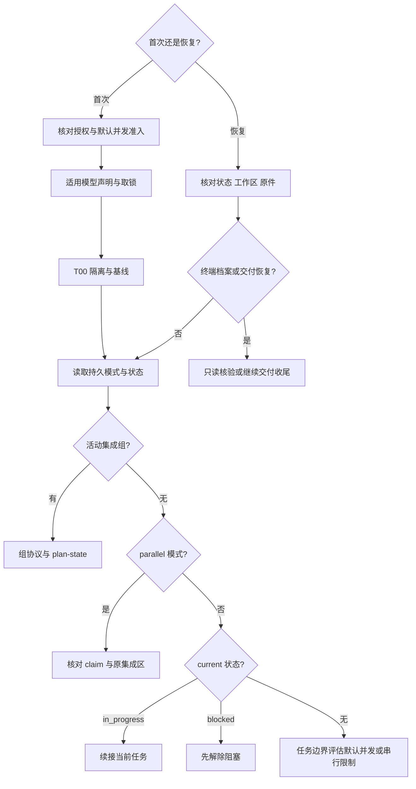

> 输出语言：用户显式指定（含平台语言设置）优先，其次跟随近期对话，否则使用英语。新产物使用创建时语言，增量修改沿用原文语言；固定话术按语义表达。

> **插件根**：`${CLAUDE_PLUGIN_ROOT}`——本 skill 正文与其 references 中的插件根命令以此为准；若上式仍为变量字面量（平台未替换），按 requirement-analysis 的 references/exploration-patterns.md「插件根解析」序列推导。

> **外部搜索统一入口**：外部检索先用 anysearch；不可用时按[搜索与降级规则](../requirement-analysis/references/exploration-patterns.md)执行。

# 执行实施计划

## 概述

载入计划 → 核对执行授权与模式 → 隔离工作区 → 执行任务图 → 独立 final 验证 → 多维审查与矩阵验收 → 对账与交付。串行与并发共用本入口；并发调度、锁与认领按需读取，不另走一套收尾流程。

**默认并发编排**：用户授权执行计划后，主线程按依赖图将可派发票交给独立 worktree 中的 implementer，不再另问是否启用并发。主线程独占进度与集成，并负责生命周期票、主线程专属票及必要的串行降级；探索和审查子代理保持只读。实际并行数量由 ready 任务、写集合、资源和平台容量决定，单条依赖链逐票推进。

## Checklist

必须为以下每一项创建任务（Claude Code 用 `TaskCreate`，Codex 用 `update_plan`）：

1. **载入并批判性审阅计划** — 有疑虑先提出；开工前过执行确认门
2. **隔离工作区** — 执行计划的任务 0（纪律遵循 using-git-worktrees）
3. **逐任务执行** — TDD + 每任务提交 + spec 自检，连续执行
4. **收尾审查** — 按规模 1/2/5 路审查，读执行回执不复跑；高/中候选才反驳；critic 按档位与显式配置触发；按验收矩阵触发 acceptance-qa
5. **审查处置与交付对账** — 例外驱动：零发现且全 DELIVERED 静默通过；否则一次性征询修复与裁决
6. **合并与总结** — 执行计划的最终任务（合并与清理，含 sync_commit 锚定），回写 roadmap 状态（如属），输出总结

## 执行入口与恢复

首次执行先核对授权、模式与准入，再从 T00 开始；采用并发编排时先完成模型声明与取锁。恢复先读已提交状态、实际工作区与证据，不重做已完成任务。终端档案只读核验；已合并但收尾未完的档案只进入交付恢复，不回到业务调度。组和并发沿各自协议，已有串行 current 优先续接，任务边界再评估默认调度。

## 阶段 1：载入并批判性审阅计划

1. 读取计划（格式嗅探）：`plan/tasks/` 子目录存在 → 分文件形态（全部新生成计划的唯一形态），按下文「渐进加载与断点恢复」节渐进加载（启动只读、按需读任务文件）；不存在 → 存量单文件形态，按 `.spec-dev/YYYY-MM-DD-NN-<feature>/plan/*-plan.md` 原样一次性读取计划全文与同特性目录 `spec/<feature>-design.md`（旧命名 `YYYY-MM-DD-<feature>` 目录按原样读取）。**该读分支为格式冻结侧**：保持单文件与复选框；恢复时核对已有授权，补当前/未执行项的范围、final 和交付步骤，保留已完成内容、SHA 与证据，不生成 progress。产物仍在历史位置 `docs/YYYY-MM-DD-<feature>/` 时保留原位置；仅沿已有明确迁移授权单独迁移，保留历史原件与提交，不把全局路径重写混入局部恢复
2. 批判性审阅：步骤有歧义？接口块互相矛盾？与代码库现状不符？——**有疑虑先向用户提出，别带着疑虑开工**
3. **执行确认门**：向用户呈现执行摘要（计划入口、任务数与依赖拓扑、将创建的 worktree 分支名）并确认开始——用户本轮已显式指示执行（如"执行这份计划"）或经 writing-plans 交接确认的，视为已确认、不重复问
4. 把计划任务注册进任务管理（每任务一条，`T{n}: 任务名` 命名），进入阶段 2

### 默认并发与任务边界切换

首次编排、任务边界切换或恢复前，实际读取 [模式切换与任务恢复](references/task-recovery.md)，再取得该文件指向的锁、认领及集成细则。已有明确串行要求继续有效；缺声明或隔离能力时说明原因并按已授权范围串行，不能以降级绕过损坏契约或未明恢复事实。

### 渐进加载与断点恢复（分文件形态＝全部新计划）

启动只读 index、progress 与 spec；执行当前票时再读其正文和依赖接口。恢复优先处理 current 的 in_progress/blocked，不重做 completed，也不把未勾选项当授权。完整状态核验、合法退役证据及冻结单文件分支先读 [模式切换与任务恢复](references/task-recovery.md)。上下文压缩后在继续操作前重新读取，不以摘要代替规则。

## 集成组分支

进入组、组内失败或恢复前，先读 [integration-groups.md](references/integration-groups.md)；不能把单票 ready/completed 套在组上，也不能把组验证当成最终验收。

## 阶段 2：隔离工作区

执行计划的任务 0（建立隔离工作区）——完整纪律遵循 using-git-worktrees skill（已隔离检测、原生工具优先、git 降级、基线测试验证），分支名对齐计划（如 `plan/2026-07-03-export-report`）。计划缺任务 0（旧版计划）时，直接调用 using-git-worktrees 补齐同等效果。T00 无论新建或复用隔离，都消费 using-git-worktrees Step 1b 的跨特性残留只读报告；同一现场已有报告则复用，不重复扫描或删除其他特性资源。基线验证范围遵循计划头部「相关测试范围」声明（判据见 using-git-worktrees Step 3 与 writing-plans 任务 0 模板）；旧版计划无该节 → 按全量执行。

**降级**：非 git 仓库或无法建立隔离时，按 using-git-worktrees 的既有纪律记录并处理；来源分支受保护不是原地实施理由，仍在隔离特性分支工作。交付与权限遵循 references/delivery-channels.md，策略无法查询时记未知。

## 阶段 3：逐任务执行

下面普通票流程不对集成组成员强行标 completed；到组入口时按 integration-groups 完成整组（含独立组验证任务），组成功后回本流程。纯重构使用 TDD 的前后保护步骤，不伪造失败。

任务 0 已在阶段 2 完成；普通实施票按依赖连续执行，随后执行独立 final 验证票 F。验收 A 留待阶段 4，最大号交付 D 留待阶段 6；F 必须先于 A/D 完成，不能等待验收再首次全量。普通实施票按序：

1. **标记 in_progress 并提交任务绑定**：先核对已有授权与精确 writes/specs，提交静态版本及绑定状态后激活 bind/inspect；完整字段与命令见 writing-plans/plan-format。再严格按计划步骤执行——计划已是 bite-sized 步骤，照做；TDD 循环遵循 test-driven-development skill（有效红→最小实现→绿）；写测试前直接消费获批 seam，存量只允许唯一提取并记录来源，缺失/冲突走主线程偏差处理。按 test-strategy 使用已有适用快检，仍执行目标测试与全部必需验证；重构候选交收尾；测试只跑本任务目标测试与计划「相关测试范围」内的自有测试，不在任务内跑回归或完整套件（独立 F 首次全量，修复按影响补验）
2. **commit**：任务完成即提交（message 对齐编号：`feat(T3): xxx`）；非 git 仓库跳过并注明
3. **spec 自检**（主线程，不派子代理）：对照本任务在计划中的验收标准重读本任务 diff，只查两件收尾审查不覆盖的事：
   - **over/under-building**——写了任务没要求的代码？漏了任务要求的产出？
   - **契约锚定**——本任务确立的契约（函数签名/数据结构/API 形态）与计划接口块一致？会不会被后续任务隐式重新解释？

   发现即就地修正并补提交（或 amend）。**禁止在此猎 bug、查风格、查规范**——那是阶段 4 的活，重复只造噪音与虚假安全感
4. **标记任务 completed**，进入下一任务（分文件先 clear 本地引用，再原子更新 progress.yaml 并独立提交，commit 指既存实现 SHA——progress.yaml 是唯一状态源；存量单文件计划沿用其复选框勾选）

**资源登记**：执行中创建了计划未预登记的持久资源（容器、测试库/表、临时目录、后台服务）时，当场登记进 progress.yaml 的 `resources` 键（writing-plans 的资源台账规范定义点；计划任务文件不被编辑）、不延迟到收尾补记，登记随本任务的提交一起提交、不为单个资源单独提交；执行**存量单文件计划**时就地编辑其最终任务内嵌的台账行（该侧冻结）。

资源创建前仍须由协调器原子持久化登记，失败日志和原件及时落盘；例行登记、候选测试失败及证据索引并入下一必要检查点，不把每次工具调用变成独立状态提交。claim/authority、范围变更、阻塞、接收完成及实际清理等可恢复状态边界仍按各自协议单独提交，不能用减重省略它们。

**连续执行**：任务之间不停下来向用户汇报或请示——用户已经确认过计划。进度汇报、阶段性提交和测试通过都不是结束点；回答用户的进度询问后，也继续原计划。仅三种情况停下：无法自行解除的 BLOCKED、真正阻断前进的歧义、全部任务完成。

**偏差处理**（三档）：

- **小偏差**（路径笔误、步骤缺失但意图明确）→ 就地修正，在最终总结中记录
- **契约级偏差**（接口/数据结构与计划不符且影响后续任务）→ 停下向用户确认修正方向，不猜着改；卡在子问题想不清时可切 exploring skill 想透再回来，洞见按其归位表回填（设计决策→修 spec 并请用户 review、新任务→补进 plan）
- **意图级偏差**（真正要做的已是另一件工作：意图变了、范围爆炸如"修登录 bug"变成"重写认证"、或原计划可独立标记完成而新工作自成一体）→ 停下建议收尾当前计划，新工作另起特性目录走 requirement-analysis——**更新保留上下文，新起提供清晰**；收尾废弃计划时，若其 spec 已激活并已打出 Superseded-pending 标注，一并回收（删除旧 spec 上的 pending 行）并在最终总结注明

**早期闭环**：首个真实流程就绪即对照定稿 HTML 验证。决定复用、设计偏差、失败分类及按影响复验沿 [验证归属](../test-strategy/references/verification-scope.md)。

## 阶段 4：收尾审查

全部实施/组验证完成并取得当前候选的有效 final 回执后，编排独立代码审查；验收和交付票此时尚未完成。完整编排（维度定义、伪代码、契约校验、Codex 降级）见 [review-orchestration.md](references/review-orchestration.md)，要点：

- **审查范围**：worktree 分支上本计划的全部变更（`git diff <base>...HEAD`）
- **维度派发**：路数、各档 S 覆盖、D 的证据触发及容量不足分批均以 review-orchestration「维度与路数」为唯一规则；预检基线/diff/契约来源后派发全部选定维度，不在此复制路数表。
- **契约校验**：每份报告落盘后 `node "${CLAUDE_PLUGIN_ROOT}/scripts/validate-output.mjs" review-findings <file>`；校验失败发回补全一次，再失败主线程接管（定义见 exploration-patterns「输出契约与校验」）
- **候选处置**：高/中候选逐条派独立子代理对抗复核（指令=试图反驳）；去重后无新候选即收口，最多 2 轮；首轮零候选直接收口，不做多轮扇出
- **completeness critic**：在存在高/中候选、大变更档、用户要求彻底或显式 critic=always 时派发；small/regular 的 on-findings 分支零高/中候选时由 AS 路 coverage_note 承担覆盖声明。一个子代理检查现行文件/Scenario 的审查与测试覆盖，已取代项排除；S 判实现偏差，critic 查证据缺口，已审零发现不等于未审。未完成补查不能因零 confirmed 而当全交付，具体收口沿共用编排。
- **acceptance-qa**：计划含验收任务、或 spec 验收矩阵含「验收任务」行时，页面按定稿 HTML 对照与业务证据核验的三步路径，其他目标按行为矩阵执行（输入=spec 路径+计划验收任务+本次变更文件清单+证据目录 `acceptance/`）；旧版计划无矩阵时，变更涉及 UI 即按其验收点触发。验收结论并入审查报告

## 阶段 5：审查处置与交付对账

**交付对账初判**（主线程）：依据 completeness critic 的覆盖缺口、任务完成记录与验收结果，逐条 Requirement 生成初判；实施中经用户确认补入的计划外行为记 ADDED-IN-FLIGHT（spec 已随偏差处理修订，此处只记账）。

**例外驱动的停顿门**（审查与对账共用一道门）：

- **零 confirmed 发现且全部 DELIVERED**（常态）→ 输出覆盖声明与对账计数，直接进入阶段 6——没有要用户决策的事，不停顿
- **存在 confirmed 发现或非 DELIVERED 嫌疑项** → 先核对已有修复授权；范围内必要修复继续完成，只对尚未裁定的范围/优先级作**一次性征询**：按严重性分组展示发现 + 列出待裁决 Requirement（补做→回阶段 3 补任务 / DEFERRED 记一句原因 / DROPPED 记一句原因 / SUPERSEDED 记后继 spec 指向——契约已移交后继、行为仍存在时用此裁决，与"不再交付"的 DROPPED 区分）——新增范围、延后或放弃交付是用户的优先级决策；不重复询问已授权的修复，也不擅自把需求记为延后

沿已有授权在 worktree 内处置：行为缺陷先写复现失败测试；纯重构按 test-driven-development「收尾纯重构」记录前后绿，缺保护先补刻画，不伪造红。修复产生新候选：先按影响补验，再复审受影响维度，并更新验收/Requirement 对账；证据仍适用才进入交付。旧 F completed、零 confirmed 或一次修复测试通过均不能替代这些门。

## 阶段 6：合并与总结

分文件计划的本地/PR 交付统一遵循 [delivery-channels.md](references/delivery-channels.md)。ready 不等于已合并；尚 awaiting_merge 时最终任务与 roadmap 保持未完成，不提前 sync_commit。存量单文件保持原读取与记录形态。

1. 审查与对账定稿后，**合并前在 worktree 内落盘并提交**：对账结果写入特性目录 `acceptance/acceptance-report.md` 的「Requirement Reconciliation」节——全绿一行带过，有偏差才展开差量表；acceptance-qa 未触发的特性按模板新建仅含头部与该节的轻量报告（一次交付一份时点记录）。DEFERRED / DROPPED 同时在 spec 原位标注（形制见 spec 模板行为规范节）；SUPERSEDED 的原位标注即取代机制的 Requirement 级 `Superseded` 标注（形制见 spec-template「取代标注形制」节，含后继指向）；DELIVERED 不标
2. 执行最大号交付 D：消费有效 final、审查和验收/对账 → 核对已验证的取代材料 → 建立保留来源历史锚并实际合并 → 原件转存与 proof 核验 → 按台账兜底补清票级闲置项并对账已清理/有因保留或移交/失败计数（无未处置项才继续）→ sync_commit 与实际交付节 → 独立最终状态提交。完整命令以 writing-plans 的交付模板和本计划实际绑定为准；旧计划只补未执行步骤，非 Git 或无 spec 如实记不适用。
3. **roadmap 状态回写（仅当 `.spec-dev/roadmaps/` 下某 active roadmap 引用本特性目录）**：把对应子项目行状态置 `delivered` 并提交，同时在该子项目的上下文胶囊追加一行「留给后继的注意事项」（交付摘要、接口变化、给下一子项目的提醒）；全部子项目已 delivered/dropped 时把该 roadmap frontmatter 的 `status` 翻 `done`。目录不存在或查无引用 → 跳过，零动作
4. 输出总结：
   - **成果清单**：完成的任务、创建/修改的文件、对账计数（`X DELIVERED / Y DEFERRED / Z DROPPED / S SUPERSEDED / N ADDED-IN-FLIGHT`）
   - **质量指标**：测试数与结果、审查发现数与修复情况
   - **偏差记录**：执行中对计划的就地修正
   - **后续建议**：优化点、文档更新
   - **roadmap 续接（仅当上一步命中 roadmap 且仍有 pending 子项目）**：列出依赖已满足的下一个子项目，询问「roadmap `<project>` 还有 N 个子项目待做，下一个是 <子项目>，现在开始它的需求设计吗？」（询问时引用下一子项目的胶囊要点，不只报名字）——用户同意后走 requirement-analysis（其 spec 已存在时直接 writing-plans）；不同意则保持 roadmap 现状，随时可续

## Red Flags

- "计划有点问题，我猜着改吧" → 契约级偏差停下问用户
- "计划在手，直接开工" → 执行确认门：显式指示或交接确认之外，先获用户点头
- "这个任务简单，跳过测试" → 仅沿 test-driven-development 的单点例外清单与既有授权，不凭简单程度豁免
- "每完成一个任务都汇报一下" → 连续执行，别打断用户
- "spec 自检时顺便找找 bug" → 自检只查 over/under-building 与契约锚定
- "把新范围混入审查修复" → 先完成已授权修复，再把尚未裁定的范围/取舍交用户决定
- "没做完的 Requirement 含糊带过" → 对账逐条裁决，DEFERRED/DROPPED/SUPERSEDED 必须记原因（SUPERSEDED 记后继指向）并回写 spec
- "零发现且全 DELIVERED 仍停下征询" → 例外驱动：没有要决策的事就静默进入合并，总结带一行计数
- "改动不大，审查跳过吧" → 收尾审查是强制步骤，规模只影响维度数
- "自己写的代码自己看一遍就行" → 审查必须由独立子代理承担
- "子项目交付了，roadmap 回头再更新" → 交付即回写 delivered 并提示续接，否则剩余子项目无声搁浅

所有实施写入都受已核验任务范围约束；字段规范见 writing-plans/plan-format。恢复已有授权时不重复索取许可；scope/spec/task/worktree/claim 变化后旧绑定失效，不能自行扩大 writes。行为变更仍同步 spec；范围核验不替代测试和审查。
