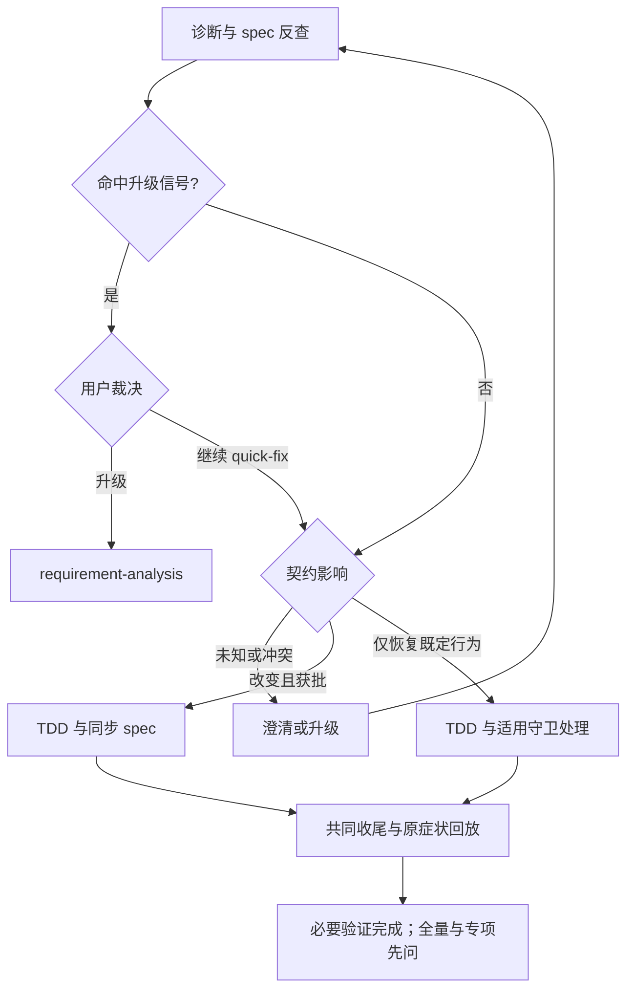

> 输出语言：用户指定了语言（含平台语言设置）就用它，否则跟随近期对话，判断不了时用英语。新文件用创建时的对话语言，修改已有文件沿用原文语言；文中给出的问句和话术按意思表达，不必逐字照搬。

> **外部搜索统一入口**：外部检索先加载 anysearch skill；不可用再用宿主自带的搜索工具。

> **宿主适配**：提问用宿主的提问工具，没有就发普通消息并停下等回复；有子代理能力才派发，没有就由主线程完成并注明；进度工具可用可不用，以落盘文件为准；需要其他 skill 时按名称加载，加载不到就读同级目录下的 `SKILL.md`。

# 轻量修复（Quick-Fix）

修已经决定要修、做法没有争议的小 bug 和小调整。流程：找根因，和用户逐题确认，先写失败测试再修，回放原症状。

动手前查这块代码有没有对应的 spec；修复会改变 spec 写明的行为时，在同一次提交里更新 spec。改动跨模块、要加新依赖、两份 spec 互相矛盾或根因查不清时，停下来让用户选：升级到 requirement-analysis，还是继续。

拿不准是小修还是需要设计时，先从 quick-fix 开始；查到根因后命中升级条件再转 requirement-analysis，已查到的内容会带过去。

## 决策路径

先找根因、查相关 spec，再看是否命中升级条件。修复对 spec 的影响还不清楚时，回去澄清或升级，不当作没有影响。用户已经做过的决定直接采用。

## 流程（6 步）

### 步骤 1：弄清问题，确认是小修

本代理自己收到 `spec-dev collaboration: enabled` 时，另按 [模型协作增强](../requirement-analysis/references/model-collaboration.md) 执行；没收到就忽略。

先弄清要修什么。开始前按 [context-reuse.md](../requirement-analysis/references/context-reuse.md) 查两件事：是否已有实现、以前是否否决过；项目有词汇表就先读。用户已经做过的决定直接采用。

**先确认这是小修。** 请求其实是新功能、牵涉多个子系统，或用户还没决定要不要做时，建议改用 requirement-analysis（需要设计）或 exploring（还没决定），由用户选。

**只修这一个问题。** 同一个症状牵涉多个文件或调用方，仍算一个问题；会话中断后接着已有结论继续。途中发现的无关问题，记下症状和位置告诉用户，不顺手修；用户明确要求一起修时再扩大范围。

**不清楚就先问。** 症状、触发条件或预期结果不明确时，按 clarifying 的方式先问清最要紧的一题。

**界面问题。** 恢复原有行为或预期明确的小调整不用出原型，修完实际打开页面看和操作一遍。涉及新增页面、主要布局或交互重新设计时，建议转 requirement-analysis，带上已确认的决定和证据。规则见 [原型契约](../visual-preview/references/ui-prototype-contract.md)；需要用户在界面方案里做选择时按 [界面澄清](../clarifying/references/ui-clarification.md)。

### 步骤 2：找根因，查相关 spec

- **找根因**：简单的自己查；线索不明时可以派 1 个只读子代理追查，派发时给出 requirement-analysis skill 的 `references/explorer-brief.md` 路径。子代理失败先缩小范围重试 1 次，再失败主线程接管。
- **查相关 spec**：读 [查找相关 spec](references/spec-discovery.md) 全文并照做，找出管着这些文件的 spec。项目没装漂移守卫也要查。

**根因不明显时先复现。** 运行已有测试、命令或接口，或重放原场景；下根因结论之前，先给出输入和触发条件、运行的命令、针对这个症状的失败输出。环境、鉴权、缺依赖、编译失败引起的报错不算复现：先修好环境，或向用户说明缺什么。已有的失败证据对当前代码仍成立时直接用，不必新写测试。测试该写在哪个公共入口还没定时，先不写测试。

**一眼能看出原因的小修。** 症状、出问题的那处代码和改法能一一对上时，说明依据后可以跳过复现这一步。后面的 TDD 照做。

**调查要有进展。** 每轮调查前说明要查什么、怎么查、预期看到什么。查到能支持、排除或区分候选原因的证据就继续；没有新证据时，汇总原始输出、已排除的原因和还缺的条件，让用户决定下一步。把同一个尝试重做一遍不算进展。

### 步骤 2.5：升级门

根据当前代码、复现结果和调查证据判断。命中下面任何一条就停下：

- **修复会改变不止一份 spec 写明的行为**，或需要在几份 spec 之间协调；
- **要改多个模块**；
- **要加新的第三方库或框架**；
- **两份 active spec 对同一行为的规定矛盾**，又没有取代声明（见 [查找相关 spec](references/spec-discovery.md)）；
- **根因查不清**：调查后仍然复现不了原症状，或一直没有新证据。偶发问题只要拿得到失败样本、能在相同条件下比较，就继续查，不因为它偶发而升级。

命中时让用户二选一：升级到 requirement-analysis，或继续用 quick-fix。不替用户选。

- **继续**：TDD 照做；修复改变 spec 行为时照样走 5a 同步 spec；两份 spec 矛盾时先请用户裁定；根因还没查清时，只做用户同意的取证，不凭猜测改代码。
- **升级**：调用 requirement-analysis，把已查到的根因、相关 spec、试过的方法和失败输出、还缺什么、用户已做的决定一并交给它的第 1 步。已查清的不重查，已回答的不重问。工具调用失败和“证据不足”分开记。

### 步骤 3：逐题校对（一次一个问题）

按 clarifying skill 的提问规则问：先说明已知和假设，一次一题，给选项并把推荐放第一个，能查到的事实不问用户。需要确认三件事：

1. **根因，或下一步往哪查**：已经确定就给出这一个根因和证据。还不确定时给 2 到 3 个按可能性排序的候选，每个附依据和一条可以验证的预测（如果是 X，做 Y 应该看到 Z），并标明哪些已证实、哪些待验证。用户选了往哪查，只决定先查哪个，不说明它就是根因；出现相反的证据就记下并改结论。修法定下来之前，不改实现代码来试猜测。
2. **用哪种修法**（有不止一种时）。
3. **修复会不会改变 spec 写明的行为**：对照相关的 Requirement 和 Scenario、当前实际行为和打算怎么修，给出判断并引用 spec 原文。只是恢复 spec 已写明的行为时直接说明结论，不用问；行为该是什么确实有取舍、spec 之间有冲突或证据不够时才问用户。没有找到相关 spec 就照实说。

### 步骤 4：按是否改变 spec 行为分两路

修复会改变 spec 里 Requirement 或 Scenario 写明的可观察行为，走 5a；只是恢复 spec 已写明的行为，走 5b。未知、冲突和证据不足时回到澄清或升级门。

### 步骤 5a：TDD 修复并同步 spec（行为有变，只涉及一份 spec）

- **先写失败测试再修**：复现失败，确认有效红，做最小修改，确认绿，按 test-driven-development 执行；例外清单以 test-driven-development skill 为准。测试写在能观察到这个 bug 的公共入口（接口、命令、页面、模块的公共函数）。spec 或计划已写明入口就用它；有多个候选时，并到步骤 3 一起问用户，定下来之前不写测试。代码已经先改了、测试还没写时，按 test-driven-development 的“既有实现的补测恢复”一节补测并照实记录。
- **测试要对得上真实故障**：输入、调用顺序、调用方与出问题时一致。只让一个抽出来的纯函数测试通过，不算修好。公共入口确实观察不到这个行为时，说明具体卡在哪里并问用户；不为测试新增生产接口，不借机重构，也不因此免测。5b 同样适用。
- **重构另算**：想到的重构只记下位置和理由，写进交付说明；真要做，按 test-driven-development 的“纯重构”一节。
- **同步 spec**：只改受影响的 Requirement 和 Scenario，让它们与新行为一致。
- **提交前把 spec 的改动给用户确认。**
- **提交**：spec、代码、测试放在同一次提交里。

### 步骤 5b：TDD 修复（行为不变）

TDD 同 5a，spec 不用改。改动的文件不在任何 active spec 的 `covers` 里时正常提交；在 `covers` 里时，动手前先读 [守卫处理](references/guardrail-handling.md) 全文，按它取得用户同意后放行。

### 修复收尾（5a/5b 共用）

- **偶发问题**：修复前后用相同的输入、环境、触发方式和观察时长各跑多次，记录“失败次数 / 总次数”和原始输出。只跑一次通过、缩短时长或换了输入，都不能用来比较。修复后零失败只说明这次没出现。做不到同条件比较就写“未验证”。
- **临时日志**：本次加的临时日志带一个唯一标记；修完按标记删干净，再验证一遍。要保留的写明位置和理由。不是本次加的、说不清是谁加的都不动。
- **回放原症状**：在删掉临时日志后的最终代码上，用原始输入把完整流程重跑一遍；回归测试的结果和原场景的结果分开写。到不了原环境时写明：本地通过、原场景未验证、缺什么、怎么补。仍然失败就照实报告。
- **交付说明**：原症状、根因和证据、改动为什么有效、运行过的命令和结果、哪些没验证。

### 步骤 6：必要验证，全量与专项验收先问

回放原症状和跑这次修复的回归测试属于修复本身，直接做，不用问。界面问题在最终代码上实际打开页面看和操作，覆盖受影响的角色、状态和视口；有定稿时对照定稿的 HTML。用户关掉了原型预览也要做这一步；环境到不了就写明原场景未验证。小修给简短结果就够。

全量回归和 acceptance-qa 专项验收一律先问用户，未获同意不执行；拿不到回复按未同意处理。用户同意后加载 acceptance-qa：命中 active spec 时传 spec、变更范围、适用原型和已有证据；没有 spec 时用原症状与已确认的预期。范围只限用户选中的项，区分本次新增的失败和既有失败。

**收尾资源清理**：修复过程创建的持久资源（测试数据或表、临时容器等）在验证完成后列出清单（标识加清理命令）请用户确认，确认后逐条清理并报告结果；用户婉拒就保留并说明位置与手动清理方式；没有创建资源时声明"无待清理资源"。共享缓存默认保留，不是自己创建的资源不动。

## 执行环境兼容性

提问、子代理和进度工具按文首的宿主适配段处理；各宿主的具体工具见 requirement-analysis skill 的 `references/host-compat.md`。沙箱禁止提交时，请用户在沙箱外执行提交。
