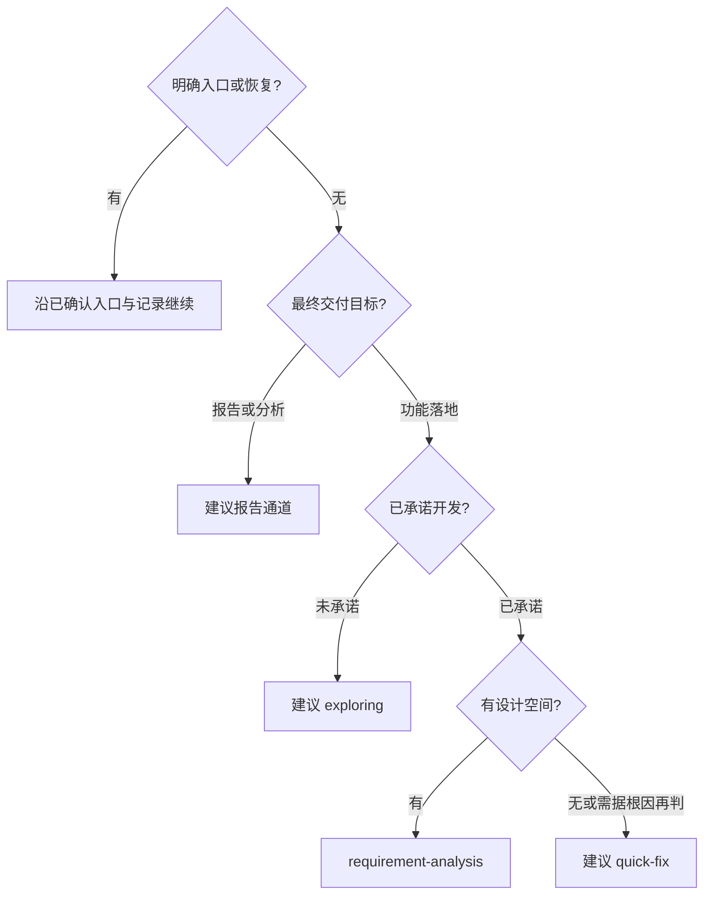

> 输出语言：用户显式指定（含平台语言设置）优先，其次跟随近期对话，否则使用英语。新产物使用创建时语言，增量修改沿用原文语言；固定话术按语义表达。

> **外部搜索统一入口**：外部检索先加载 anysearch skill；不可用再用宿主自带的搜索工具。

> **宿主适配**：提问用宿主的提问工具，没有就发普通消息并停下等回复；有子代理能力才派发，没有就由主线程完成并注明；进度工具可用可不用，以落盘文件为准；需要其他 skill 时按名称加载，加载不到就读同级目录下的 `SKILL.md`。

# 需求设计工作流

四步：理解与探索、逐题澄清、设计提案、落盘 spec。用户只需要批准一次设计，批准后直接进入 writing-plans。

<HARD-GATE>
设计提案展示给用户并获得批准之前，不得调用实施类 skill、编写生产实现代码或搭建生产脚手架。按原型契约在隔离位置生成 HTML 设计产物属于澄清，可以在批准前进行，但不能据此修改生产代码。这道门适用于所有项目，无论需求看起来多简单。
</HARD-GATE>

"简单"的需求恰恰是未经检验的假设造成返工最多的地方。简单需求的提案可以只有几句话，但不能跳过批准。

## 入口判断

先消费明确的入口或恢复信息；新请求按最终交付目标、是否已承诺开发、有没有设计空间来判断。路由只是建议，由用户裁决；已有的决定不重复问。

- **还在犹豫要不要做**：建议 exploring。已有 `.spec-dev/explorations/` 笔记时作为第 1 步的输入，探索过的部分不重做。
- **已决定、无设计空间的小修**（单点 bug、单个常量或文案）：建议 quick-fix。大小拿不准的也先走 quick-fix，它有基于根因证据的升级门，升级便宜、降级浪费。
- **报告通道**：最终交付物本身是调研报告、方案对比、日志分析，且没有要求功能落地时使用。不建特性目录、不写 spec；产出结论后问一次是否落盘为 `.spec-dev/reports/YYYY-MM-DD-NN-<topic>.md`。已经明确要交付功能时，本轮只做设计也仍属于开发流程。报告通道不是实施的后门，结论要落地成代码时回到正常入口。

## 探索深度

档位只调节探索深度和 spec 篇幅，不改变批准次数。在第 1 步判定并告诉用户：「本需求判定为 {档位}（理由），需要更彻底或更轻量请告知」。

| 档位 | 何时 | 探索 | 额外动作 |
|---|---|---|---|
| light | 单文件或单模块、无新依赖、无方案分歧 | 主线程直查 | 无 |
| standard（默认） | 跨 2 到 3 个模块，或有方案取舍 | 主线程直查为主，必要时派 1 到 2 个只读子代理 | 顺带看相邻测试、公共入口和 fixture 惯例 |
| deep | 跨层架构变更、新技术栈、用户说"彻底、全面、审计" | 按主题派多个只读子代理 | 设计提案展示前派一个独立子代理审 spec |

## 第 1 步：理解与探索

目标是拿齐做设计需要的事实。

- **读规范与代码**。先读项目规范文件，再读相关代码，理解核心功能、业务实体、约束和成功标准。
- **复用已有上下文**。按 [context-reuse.md](references/context-reuse.md) 核查已有实现、历史否决和共享术语；已有的有效决定直接用。
- **范围分解**。需求的意图要能用一句话说清，说不清就该拆。读起来像不相关的功能清单、或描述了多个独立子系统时，先帮用户拆成子项目，经确认后按 [roadmap 模板](assets/roadmap-template.md) 登记到 `.spec-dev/roadmaps/` 并提交，再只对第一个子项目走本流程。需求命中某个 roadmap 的既有子项目时，载入它的上下文胶囊继续，不重新分解，也不要求用户重新提供原始需求。
- **契约姿态**。需求带破坏性重构信号（"重构""推翻""不留兼容"）且会触及既有 active spec 或 ADR 时，先用一道澄清题确认这些旧契约是硬约束（默认）还是仅作现状输入。
- **探索方式**。默认主线程直查。派子代理时，派发词带上 [探索 brief](references/explorer-brief.md) 的绝对路径；核查第三方依赖、服务或标准的事实时带 [外部研究 brief](references/external-research-brief.md) 的绝对路径，本地存放的第三方材料也按外部事实处理。每个子代理给定有界主题、来源线索、可判定的完成条件和排除项。子代理失败先缩小范围重试 1 次，再失败主线程接管。
- **读 `.spec-dev/` 既有文档时**：active 的 spec 和 Accepted 的 ADR 是现行契约；superseded 的、带 Superseded 标注的只作历史参考。计划、验收报告和探索笔记是时点记录，代码现状以仓库为准。

## 第 2 步：逐题澄清

目标是解决所有会改变方案的模糊、歧义和取舍。

提问纪律遵循 clarifying skill（被引用模式）：一次一题，能自查的事实不问用户，具体取舍给选项并把推荐放首位。澄清完直接进入第 3 步，不做独立的共识摘要。

- 优先覆盖目的、约束、成功标准，以及第 1 步暴露的歧义、约束冲突、隐含假设和边缘场景。
- 用词模糊时当场定下规范术语，之后全程沿用。
- 列出实际的参与者（用户角色、调用系统、后台触发者）及各自适用的行为与错误路径；没有的类别不凑数。
- 新增页面、重新设计、主要布局或核心交互变化时，按 visual-preview 的 [原型契约](../visual-preview/references/ui-prototype-contract.md) 展示 HTML 原型，界面问题沿 [界面澄清](../clarifying/references/ui-clarification.md) 逐题确认；小改动、用户关闭预览或已有定稿时按其例外处理。
- 澄清中发现新库或新领域，可以回补一轮探索再继续。

## 第 3 步：设计提案

目标是用一条消息让用户看到完整设计并一次批准。提案包含：

1. **承重事实**。决定方案取舍的事实逐条标明来源。外部做法与代码库现状矛盾时回读代码裁决；未验证的假设标出来，能在代码里验证的立即验证，只能由用户定的回第 2 步问。冲突没消解不给方案。
2. **推荐方案和备选**。推荐方案说明核心思路、与现有模式的契合度、改动半径和风险；备选各用一句话说明为什么不选。确实没有分歧时只给一个方案并说明原因。方案对照 writing-plans 的 [设计原则](../writing-plans/references/design-principles.md)，删掉没人要求的功能。
3. **一页 spec 草稿**。按 [spec 模板](assets/spec-template.md) 写目标与成功标准、非目标、关键决策、行为规范。涉及新增或调整公共接口、跨模块契约或 CLI 时，先写调用方的正常用法和相关失败结果，再定签名。有界面时写明采纳的定稿 HTML 版本和模拟边界。

展示之前自检草稿：有没有占位符或没写完的节；各节是否互相矛盾；意图能否一句话说清、有没有"第一阶段、第二阶段"式的伪聚焦；有没有能读出两种意思的需求；每条 Requirement 是否一个 SHALL 且可观察、是否至少有一个真正检验它的 Scenario。

deep 档在展示前派一个不继承主会话上下文的子代理，按 [spec 审查提示词](references/spec-reviewer-prompt.md) 审一遍。发现分三类处理：已有答案的补上来源；不改变范围和行为的细节由代理决定并标注；只有会改变交付或重要取舍的才带给用户。

然后问用户：

> 「批准这份设计吗？批准后我落盘 spec，并直接开始写实施计划。」

用户有修改意见就修订后整篇重发，不分章节逐节确认。批准即同意落盘 spec 并编写计划；用户只想要 spec 时在第 4 步结束后停下。

## 第 4 步：落盘 spec

按 [spec 落盘与生命周期](references/spec-lifecycle.md) 创建特性目录、写入并提交 spec。然后加载 writing-plans 生成实施计划。

本 skill 之后唯一可以调用的是 writing-plans。认可 spec 内容不等于授权实施，不直接调用 executing-plans。

## Red Flags

- "这太简单了，直接写代码吧" → HARD-GATE 适用于一切需求。
- "一次多问几个问题效率高" → 一次一个。
- "外部搜到的做法直接用" → 先与代码库事实对照。
- "方案很明显，不用说备选" → 说明为什么没有分歧。
- "顺手把代码也写了" → 本 skill 的终点是 writing-plans。
- "项目太大，先做第一部分，剩下的以后再说" → 分解必须登记 roadmap，没登记的"以后"等于不存在。
- "spec 里分个阶段就能装下大目标" → 阶段化的 spec 是没登记的分解，拆成 roadmap 子项目。
